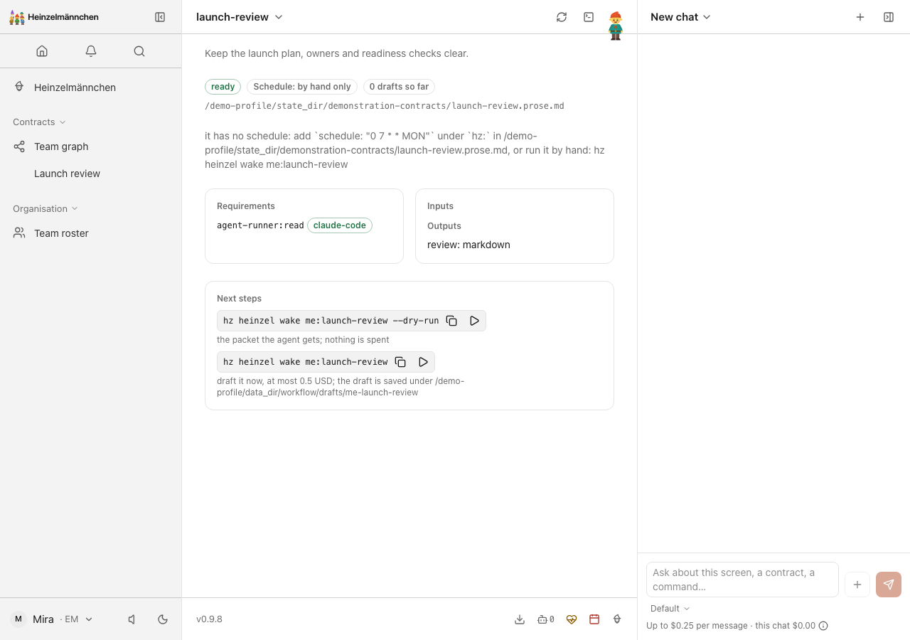
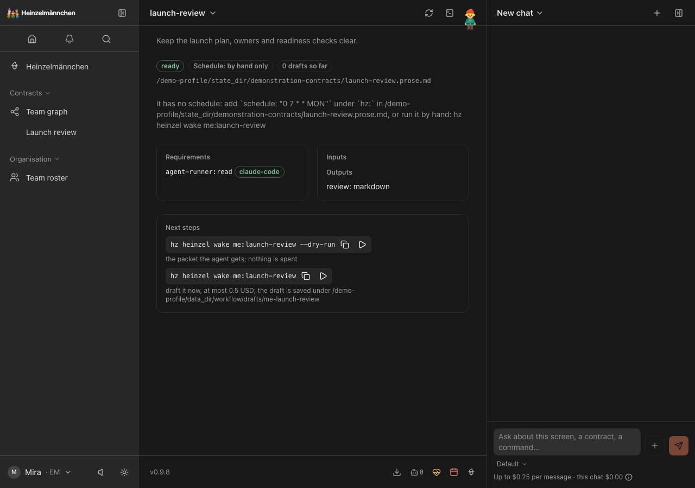

# Heinzelmännchen plugins

<!-- badges:start -->
[](https://github.com/helmut-hoffer-von-ankershoffen/heinzel-plugins/actions/workflows/ci.yml) [](https://github.com/helmut-hoffer-von-ankershoffen/heinzel-plugins/tree/python-coverage-comment-action-data) [](https://github.com/helmut-hoffer-von-ankershoffen/heinzel-plugins/actions/workflows/codeql.yml) [](pyproject.toml) [](https://sonarcloud.io/summary/overall?id=helmut-hoffer-von-ankershoffen_heinzel-plugins) [](https://sonarcloud.io/summary/overall?id=helmut-hoffer-von-ankershoffen_heinzel-plugins) [](LICENSE)
<!-- badges:end -->

**More to see and more to read from: a world clock, resource meters, weather, themes with soundscapes, and adapters
for GitHub, Jira and Confluence, Google Workspace and Zoom.** Ten independent plugins for
[Heinzelmännchen](https://github.com/helmut-hoffer-von-ankershoffen/heinzel), the open-source crew of AI helpers that drafts your team's busywork and asks before anything
leaves your machine. Real screens from the running app, with fictional data, are below; every plugin has a full gallery in the catalog.

[**Explore the plugin catalog →**](https://helmut.hoffer-von-ankershoffen.me/heinzel/CATALOG/) · [Install the app](#install) · [Build your own plugin](#add-a-plugin)

<table><tr><td width="96"></td><td>

**Pip:** "I find a time that works for everyone." Start with the World Clock below: it ships with the standard app.

</td></tr></table>

## See what the plugins add

[Explore the plugin catalog →](https://helmut.hoffer-von-ankershoffen.me/heinzel/CATALOG/) · [Install the standard app →](https://helmut.hoffer-von-ankershoffen.me/heinzel/guides/install/)

These are real plugin interfaces running with fictional demonstration data. Each catalog page includes its full
UI and CLI gallery; theme pages also list their optional soundscapes.

### Find a time that works across the team

[](https://helmut.hoffer-von-ankershoffen.me/heinzel/catalog/heinzel-clock-a8638667a9/)

Find overlap across Berlin, New York and Los Angeles while staying on Today — demonstration time · [Explore Clock →](https://helmut.hoffer-von-ankershoffen.me/heinzel/catalog/heinzel-clock-a8638667a9/)

<table><tr>
<td align="center" valign="top"><a href="https://helmut.hoffer-von-ankershoffen.me/heinzel/catalog/heinzel-clock-a8638667a9/"></a><br><sub>Team working hours at a glance: Today, sidebar ticker and primary footer clock — demonstration time</sub></td>
<td align="center" valign="top"><a href="https://helmut.hoffer-von-ankershoffen.me/heinzel/catalog/heinzel-clock-a8638667a9/"></a><br><sub>The live globe and all three team clocks on a phone — fixed demonstration time</sub></td>
</tr></table>

### Understand what is slowing this computer down

[](https://helmut.hoffer-von-ankershoffen.me/heinzel/catalog/heinzel-resource-c3ccd26ae0/)

A quick CPU summary on Today, with three compact footer meters — demonstration values · [Explore Resource →](https://helmut.hoffer-von-ankershoffen.me/heinzel/catalog/heinzel-resource-c3ccd26ae0/)

<table><tr>
<td align="center" valign="top"><a href="https://helmut.hoffer-von-ankershoffen.me/heinzel/catalog/heinzel-resource-c3ccd26ae0/"></a><br><sub>CPU, memory and scaled load in the expanded monitor — fictional demo workstation</sub></td>
<td align="center" valign="top"><a href="https://helmut.hoffer-von-ankershoffen.me/heinzel/catalog/heinzel-resource-c3ccd26ae0/"></a><br><sub>Read CPU, memory and queued load on a phone — fictional demo workstation</sub></td>
</tr></table>

### See the weather before your next meeting or commute

[](https://helmut.hoffer-von-ankershoffen.me/heinzel/catalog/heinzel-weather-d59846a40e/)

Current weather and the coming days on Today — fictional Berlin forecast · [Explore Weather →](https://helmut.hoffer-von-ankershoffen.me/heinzel/catalog/heinzel-weather-d59846a40e/)

<table><tr>
<td align="center" valign="top"><a href="https://helmut.hoffer-von-ankershoffen.me/heinzel/catalog/heinzel-weather-d59846a40e/"></a><br><sub>Inspect conditions, feels-like temperature and rain chance — fictional local forecast</sub></td>
<td align="center" valign="top"><a href="https://helmut.hoffer-von-ankershoffen.me/heinzel/catalog/heinzel-weather-d59846a40e/"></a><br><sub>Weather and near forecast in the phone-sized Today view — fictional local forecast</sub></td>
</tr></table>

### Make the whole app yours in light and dark

<table><tr>
<td align="center" valign="top" width="50%"><a href="https://helmut.hoffer-von-ankershoffen.me/heinzel/catalog/heinzel-theme-5e723a7d8a/"></a><br><sub>The installed Heinzelmännchen theme on a representative local contract — light appearance</sub></td>
<td align="center" valign="top" width="50%"><a href="https://helmut.hoffer-von-ankershoffen.me/heinzel/catalog/heinzel-theme-5e723a7d8a/"></a><br><sub>The installed Heinzelmännchen theme on a representative local contract — dark appearance</sub></td>
</tr></table>

[Explore the standard theme →](https://helmut.hoffer-von-ankershoffen.me/heinzel/catalog/heinzel-theme-5e723a7d8a/)

<details>
<summary>Command line</summary>


The same team zones and working hours in the CLI — fixed fictional demonstration time


The same fictional CPU, memory and raw load measurements in the CLI


A concise three-day outlook through the real CLI — local fictional forecast

</details>

Connectors and the example plugin have full galleries too. [Browse them all in the catalog →](https://helmut.hoffer-von-ankershoffen.me/heinzel/CATALOG/)

## The plugins

Each one is its own project in [`plugins/`](plugins/) with its own code, tests, version and releases.

- **[World Clock](https://helmut.hoffer-von-ankershoffen.me/heinzel/catalog/heinzel-clock-a8638667a9/) · [source](plugins/heinzel-clock)** — What time it is for everyone on the team, on a globe and in a footer clock. *In the standard app.* Add it with `hz system plugin add clock --confirm`.
- **[System Resources](https://helmut.hoffer-von-ankershoffen.me/heinzel/catalog/heinzel-resource-c3ccd26ae0/) · [source](plugins/heinzel-resource)** — CPU, memory and load meters, and a Today widget. *In the standard app.* Add it with `hz system plugin add resource --confirm`.
- **[Tailscale](https://helmut.hoffer-von-ankershoffen.me/heinzel/catalog/heinzel-tailscale-d13884e4ee/) · [source](plugins/heinzel-tailscale)** — Private sharing of the web app over your tailnet. Off until you turn it on. *In the standard app; needs the Tailscale client.* Add it with `hz system plugin add tailscale --confirm`.
- **[Heinzelmännchen theme](https://helmut.hoffer-von-ankershoffen.me/heinzel/catalog/heinzel-theme-5e723a7d8a/) · [source](plugins/heinzel-theme)** — The app's look in light and dark, and three soundscapes that start only when you press Play. *In the standard app.* Add it with `hz system plugin add theme --confirm`.
- **[Weather](https://helmut.hoffer-von-ankershoffen.me/heinzel/catalog/heinzel-weather-d59846a40e/) · [source](plugins/heinzel-weather)** — Weather now and for the coming days, keyless from Open-Meteo, with a heads-up when it changes. *Optional.* Add it with `hz system plugin add weather --confirm`.
- **[GitHub](https://helmut.hoffer-von-ankershoffen.me/heinzel/catalog/heinzel-github-2d8dc93d74/) · [source](plugins/heinzel-github)** — Pull requests and issues, read through your `gh` login. *Optional; needs `gh`.* Add it with `hz system plugin add github --confirm`.
- **[Atlassian](https://helmut.hoffer-von-ankershoffen.me/heinzel/catalog/heinzel-atlassian-4aefc9d27e/) · [source](plugins/heinzel-atlassian)** — Jira issues and Confluence pages, read through your `acli` login. *Optional; needs `acli`.* Add it with `hz system plugin add atlassian --confirm`.
- **[Google Workspace](https://helmut.hoffer-von-ankershoffen.me/heinzel/catalog/heinzel-google-49accfe7d6/) · [source](plugins/heinzel-google)** — Docs, Sheets, Drive, Calendar and Gmail, through the Google Workspace CLI. *Optional; needs `gws`.* Add it with `hz system plugin add google --confirm`.
- **[Zoom](https://helmut.hoffer-von-ankershoffen.me/heinzel/catalog/heinzel-zoom-af3d213754/) · [source](plugins/heinzel-zoom)** — Meetings and decisions, read from Zoom's meeting-summary emails through your mail adapter. *Optional; needs a mail adapter.* Add it with `hz system plugin add zoom --confirm`.
- **[Example](https://helmut.hoffer-von-ankershoffen.me/heinzel/catalog/heinzel-example-3a92941575/) · [source](plugins/heinzel-example)** — How a plugin is built: one module with an operation, settings and a health check. *Optional; for plugin authors.* Add it with `hz system plugin add example --confirm`.

The adapters for your tools run as you, through each vendor's own command-line login. `hz system doctor` lists
what is missing and the command that fixes it.

## Install

Plugins need Heinzelmännchen. One command installs the app with its default plugins (the first four above) and opens it:

```sh
uvx heinzel@latest
```

No uv yet? The guided installer sets it up first:

```sh
curl -LsSf https://helmut.hoffer-von-ankershoffen.me/heinzel/install.sh | sh
```

Supported on **macOS and Linux**; Windows may work, but is not supported. Details: the
[standard app installation guide](https://helmut.hoffer-von-ankershoffen.me/heinzel/guides/install/).

Add any other plugin from a second terminal. Without `--confirm` the command only previews what it would install:

```sh
hz system plugin add weather
hz system plugin add weather --confirm
```

## Work on one plugin

You need git, make and uv. No core checkout or sibling plugin environment is needed. The tooling's installation
policy and reviewed input boundaries are in [SECURITY_REVIEW.md](SECURITY_REVIEW.md). Coverage measures the shared
developer toolkit; each plugin enforces its own coverage gate in its owning checks.

```bash
make list
make check-fast NAME=resource
make check NAME=resource
make preview NAME=clock
make screenshots NAME=clock OPEN=1
make screenshots-check NAME=clock
make build NAME=clock
make acceptance NAME=clock
make release NAME=clock
```

Each project's lock selects its compatible released SDK. For a candidate SDK, add `CORE=/path/to/core.whl`.
CI can download a candidate wheel from an official Core Actions run with the `core_run` input or
`CORE_CANDIDATE_RUN` repository variable. It installs the artifact and never builds or tests Core.

`check-fast` runs owning lint and offline unit/integration tests. `check` runs the owning plugin's formatting, lint, spelling, strict mypy/Pyright, Python tests and coverage (at least
90%), plus its declared frontend checks. `acceptance` installs built core/plugin wheels into a separate environment
and runs the owning head and browser tests. `release` checks and builds one plugin and prints its independent tag/artifacts.
It publishes nothing. The Release workflow previews by default; its explicit publish option creates that plugin's
tag, GitHub release and optional PyPI artifacts with build provenance. `make publish NAME=<name>` dispatches that
workflow from clean, current main. Public PyPI publication uses its protected environment and trusted publisher.

`preview` uses isolated application state under the owning `.preview/`. It preserves your normal configuration.
Restart after rebuilding loaded view assets; Ctrl-C stops the preview.

## Capture your plugin

`make screenshots NAME=<plugin> OPEN=1` first asks an agent to define a useful story from the owning source,
then captures the real UI and CLI with fictional fixtures. An independent agent reviews every image and transcript
before gallery assets, catalog metadata and the owning README update. Missing review preserves the private draft.
Use `hz-plugin screenshots <plugin> --plan` to edit the story first, `--draft --open` for a private preview, and
`--check --json` for offline freshness. New collection plugins use this same workflow.
See [Screenshot authoring](docs/SCREENSHOT_AUTHORING.md) for editable scenes, prepared interpreters and exact review receipts.

## Add a plugin

Create the complete owning project with one command:

```bash
make new NAME=harbor
make check-fast NAME=harbor
make check NAME=harbor
make build NAME=harbor
make acceptance NAME=harbor
```

The minimal starter contains one operation and behavior test, installed acceptance and concise human/agent guides.
It adds only `plugins/heinzel-harbor/`, without a parent registration, copied workflow or embedded Git repository.
The new directory includes its own small Makefile: `cd plugins/heinzel-harbor` and use `make check-fast`,
`make check`, `make build` and `make publish` directly. Root `NAME=<owner>` commands are optional conveniences.
Use `make new NAME=harbor PRESET=contributions` when a richer example is useful.
Each Python operation becomes a CLI command, MCP tool and API operation.
`hz system plugin sdk <new-directory>` exports the versioned browser SDK and types for bundled views.
The starter's static view needs no JavaScript tooling.

The scaffold creates its independent dependency lock. After changing dependencies, refresh it:

```bash
make lock NAME=<distribution> CORE=<compatible-built-core-wheel>
make check NAME=<distribution> CORE=<compatible-built-core-wheel>
```

Commit both `requirements.lock` and `plugin-lock.json`. Checks enforce the lock's hashes, refuse changed dependency
inputs, and reject incompatible core metadata. Dependencies on concrete plugin implementations are rejected.
Plugins can add ordinary runtime and development dependencies in their own `pyproject.toml`, then regenerate their
own lock. This requires no core dependency change or sibling environment.
Plugins may implement and consume public interfaces, capabilities and lets from the SDK or an implementation-free
contract package. Provider selection happens through contracts and bindings. Declare versioned `requires` and
`provides` contract identifiers in `[tool.heinzel.plugin]` so the planner also selects affected consumers.

```bash
make plan BASE=origin/main
make plan CONTRACT=core:plugin-api@1 CORE=<candidate-core-wheel>
```

The work plan and command timings are visible in CI. Plugin-only changes select no core tests, core build or native
app jobs. A standalone external repository works equally: add its `heinzel-plugin` GitHub topic and a valid root
project. Core's catalog reads metadata automatically, including new plugin directories in configured source repos.
Commit and push hooks select the owning plugin and declared contract consumers through `hz-plugin check-changed
--git-hook`, including deleted paths. Unrelated changes are a no-op; shared-tooling changes still check tooling.

## Custom public and private repositories

Plugins do not have to live here. Follow the
[custom plugin author guide](https://github.com/helmut-hoffer-von-ankershoffen/heinzel/blob/main/docs/PLUGIN_AUTHORING.md)
to scaffold a standalone repository with `hz system plugin new heinzel-harbor --defaults --data plugin_name=harbor`.
Its `make setup`, `check-fast`, `check`, `preview`, `build`, `acceptance`, `release` and `publish` commands use the
same versioned developer toolkit. No checkout of this repository or core is needed.

Choose `gh repo create ... --public` or `--private`; add topic `heinzel-plugin` for catalog discovery. Private
discovery and HTTPS Git installation use the installing person's `gh auth login`. A private plugin publishes to
private GitHub releases, never public PyPI. Public packages can choose GitHub-only publication with
`REGISTRY=github`; default public publication uses the distribution's PyPI trusted publisher. Every release is
immutable. `TAG=<distribution>/v<version> REGISTRY=pypi` resumes an existing public GitHub release after verifying
its original commit, digests and provenance, without rebuilding it.

Private repositories skip public advisory queries to keep private package names local. An owning
`tool.heinzel.plugin.audit_command` can run an internal audit tool; without it, private checks verify locks and
installed compatibility but do not run a vulnerability advisory audit. Set repository variable
`PRIVATE_ATTESTATIONS=true` only on a GitHub plan supporting private attestations. The author guide explains both
release paths and their prerequisites.

The toolkit is a development dependency, independently released as a GitHub wheel under `tools-v<version>`.
It has no plugin entry point and needs no additional PyPI publisher. Root `make tooling-check` checks the shared
toolkit; use `NAME=<owner>` for plugin commands. `make preflight NAME=<owner>` includes that plugin's full checks,
build, audit and installed acceptance. Toolkit tests do not run core's suite.

## For maintainers

<details>
<summary>How the standard app is composed, and where the plugins came from</summary>

## Standard app

Only locally reviewed metadata can enroll a plugin in the `standard` profile. Topic discovery never enrolls defaults.
The composition workflow verifies an official core release and independently released plugin artifacts, runs
installed acceptance on those exact wheels, and proves installation into a fresh environment before publishing a
digest-pinned profile. It does not rebuild plugin releases. Enable the scheduled workflow only after the matching
SDK and default providers have been published and verified. When enabled, every fifteen minutes it checks for a newly published
SDK without a complete standard app, verifies GitHub/PyPI artifact identity, and composes the missing release.
The accepted SDK must first validate the current app lifecycle (`format=2`, independently of the plugin ABI `sdk=1`),
before any provider acceptance work. Legacy compositions remain immutable and are never relabeled as compatible.
An existing complete composition is a no-op. The public quick start is always `uvx heinzel@latest`; versions stay in
machine-readable release metadata and locks.
Clock, Resource, Tailscale and the Heinzelmännchen theme are included and active by default. Sharing stays off until
explicitly enabled. An unconfigured app uses its theme recommendation; saved theme choices stay authoritative and installation starts no playback.
User disable/removal choices survive a profile refresh. Minimal core has no plugin dependencies.

```bash
make profile CORE=<built-core-wheel>
```

This writes a local profile from already-built owning artifacts. The approved composition workflow produces the
release profile consumed automatically by `uvx heinzel@latest`. Plugin releases remain independent of app composition.

## Migration provenance

The initial migration moves Clock, Tailscale, Atlassian, GitHub, Google and Zoom from
[heinzel](https://github.com/helmut-hoffer-von-ankershoffen/heinzel), and Weather and Example from the retired `heinzel-contrib` repository.
Resource is the only built-in module extracted in this migration. Sound, Theme and the other core modules remain in core.
Earlier core history and attribution remain in the core repository; current plugin sources live here. Existing public distribution names stay
stable; the migration versions advance independently before publishing the changed artifacts.

## Standard app discovery authority

The standard app composition workflow owns this repository's latest GitHub release designation. It serializes
publication, verifies the complete immutable artifact set, and explicitly publishes an `app-v` release as latest.
Plugin and toolkit releases explicitly use `--make-latest false`, so an independent plugin release cannot replace
the installation target. An older app retry does not supersede a newer app; unknown current app identity blocks
promotion. This requires the one governed composition writer and does not fence arbitrary out-of-band writers.

The installer resolves the public latest redirect to its canonical stable app tag, then verifies the immutable
profile and package identities/hashes. It needs no anonymous GitHub API quota or GitHub login for standard installation.
The bootstrap SDK version does not select the app version. Existing app tags encode their profile's `core_version`;
this repair does not introduce a new composition schema. See the Core [launcher decision](https://github.com/helmut-hoffer-von-ankershoffen/heinzel/blob/main/docs/adr/0110-one-versionless-launcher-installs-and-opens-the-standard-app.md).

</details>
