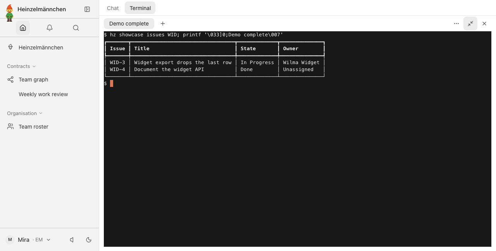
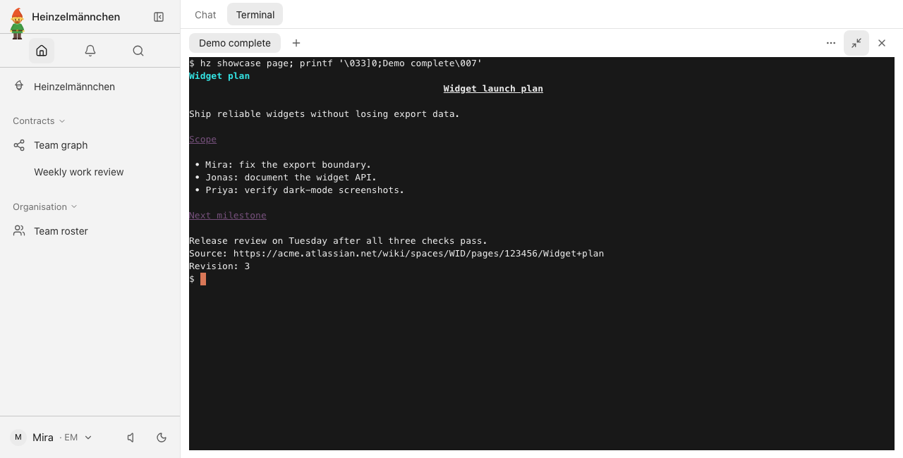
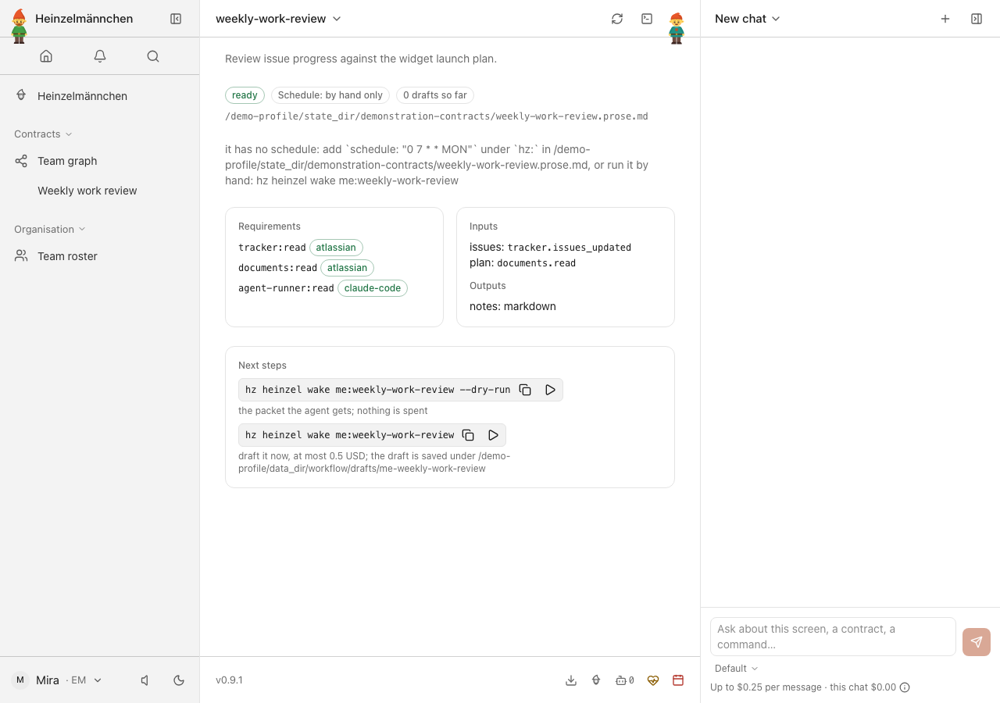
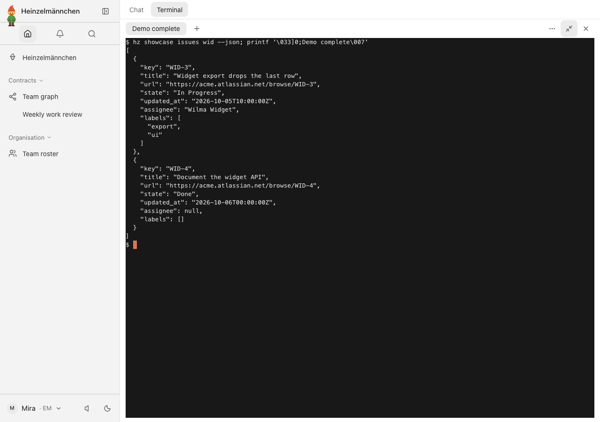
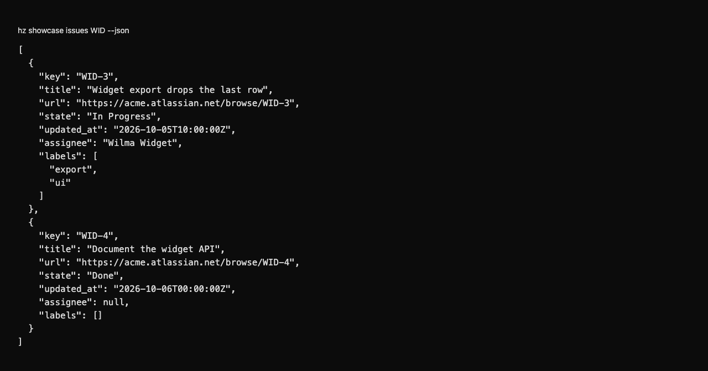
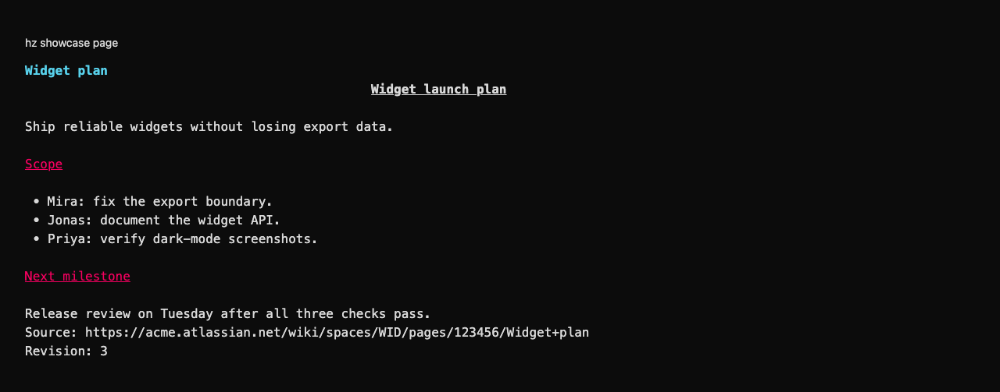

# heinzel-atlassian

Read Jira issues and Confluence pages, and draft Jira changes a person approves, through Atlassian's CLI `acli`: the `tracker` and `documents` capabilities
([ADR 0028](https://github.com/helmut-hoffer-von-ankershoffen/heinzel/blob/main/docs/adr/0028-integrations-are-capability-adapters.md)): a first-party
[Heinzelmännchen](https://github.com/helmut-hoffer-von-ankershoffen/heinzel) plugin.

Install it with:

```bash
hz system plugin add atlassian --confirm
hz system plugin remove heinzel-atlassian
```

## Set up

The plugin does only what you could do yourself: every read runs [acli](https://developer.atlassian.com/cloud/acli/),
logged in as you ([ADR 0035](https://github.com/helmut-hoffer-von-ankershoffen/heinzel/blob/main/docs/adr/0035-integrations-go-through-vendor-clis-as-an-ordinary-employee.md)). It stores no token and needs no app an administrator registers. Install acli 1.3.39 or later
([guide](https://developer.atlassian.com/cloud/acli/guides/install-acli/)) and log in to both products, in the
browser or with an API token without scopes:

```bash
acli jira auth login --web
acli confluence auth login --web
```

Name the site acli is logged in to, and bind the adapter, in your user configuration (never a project `hz.toml`,
which Heinzelmännchen ignores for both):

```bash
hz system config set atlassian.site_url https://acme.atlassian.net
hz system config set capabilities.tracker atlassian
hz system config set capabilities.documents atlassian
```

which together write

```toml
[atlassian]
site_url = "https://acme.atlassian.net"

[capabilities]
tracker = "atlassian"
documents = "atlassian"
```

Or per shell: `HZ_ATLASSIAN__SITE_URL`, `HZ_CAPABILITIES__TRACKER=atlassian`, `HZ_CAPABILITIES__DOCUMENTS=atlassian`.
`site_url` must be `https://<site>.atlassian.net` (a pasted `.../wiki` is trimmed). The plugin builds issue and page
links on it and accepts page URLs only on it. acli decides which site it reads. After a login with an API token,
an answer that names another site (an issue's `self`, a page's `_links.base`) is refused with `acli jira auth switch`
and the setting to change. **After a browser login the check can't work**: answers come through Atlassian's gateway
(`api.atlassian.com/ex/<product>/<cloud id>`), name no site, and are taken as they are, so keep acli on the site you
configured (`acli jira auth switch`, `acli confluence auth switch`), or links point at the wrong site. Matching the
cloud id would need a request of the plugin's own; doctor says so. Optionally,
`atlassian.timeout` sets the seconds each acli command may take (default 60), and `atlassian.acli` the program (a name
looked up on absolute `PATH` entries, or an absolute path; default `acli`). A project `hz.toml` can set none of the
three.

Upgrading from the release that stored an API token: the plugin no longer reads it. Remove it with your keychain's
own tool (on macOS: `security delete-generic-password -s heinzel/atlassian -a atlassian-token`), and drop
`atlassian.email` from your configuration.

### Is it connected?

Bound automatically while it is the only installed adapter of a capability, [ADR
0055](https://github.com/helmut-hoffer-von-ankershoffen/heinzel/blob/main/docs/adr/0055-connectors-show-their-sign-in-test-live-on-demand-and-bind-themselves-when-alone.md). `hz
system connector list` (or Settings → Connectors in `hz ui`) shows the site and the login command; whether acli is
logged in is only known after `hz system connector test atlassian`, which reads one Jira work item (`acli jira workitem
search --limit 1`) and, when `documents` is bound to it, one Confluence space (`acli confluence space list --limit 1`),
15 s at most each, and only when you run it.

## Use

Workflows ask for `tracker` and `documents`, never for Jira or Confluence:

```python
from datetime import datetime

from heinzel import Document, Documents, Issue, Module, Tracker, Window

module = Module("digest", "Weekly digest.", requires=["tracker:read", "documents:read"])


@module.operation
def updated(tracker: Tracker, since: datetime, until: datetime) -> list[Issue]:
    """Issues updated this week."""
    return tracker.issues_updated("WID", Window(since=since, until=until))


@module.operation
def plan(documents: Documents) -> Document:
    """The plan, as Markdown."""
    return documents.read("https://acme.atlassian.net/wiki/spaces/WID/pages/123456/Widget+plan")
```

| Method | Capability | acli command |
| --- | --- | --- |
| `issues_updated(project, window)` | `tracker:read` | `acli jira workitem search --jql 'project = "WID" AND updated >= <ms> AND updated < <ms> ORDER BY updated ASC, key ASC' --fields key,summary,status,assignee,labels --paginate --json`, then `acli jira workitem view <key> --fields summary,status,assignee,labels,updated --json` for each issue (search refuses `updated` as a field) |
| `read(ref)` | `documents:read` | `acli confluence page view --id <id> --body-format storage --json` |

- **Projects** are Jira project keys such as `WID` (lower case is upper-cased); anything else is refused before acli
  runs, so no input reaches JQL unchecked. Windows are half-open `[since, until)` with timezone-aware times, sent as
  epoch milliseconds widened to whole minutes, which Jira compares as instants whatever your profile's time zone;
  the exact window is applied to the results, which come oldest first, each issue once. More than 200 issues in
  one window is refused with a request for a shorter one. `state` is the status name, `assignee` the display name,
  `labels` the issue's labels.
- **Documents** are a page id (`123456`) or a page URL on your site: `/wiki/spaces/<space>/pages/<id>/...` or
  `/wiki/pages/viewpage.action?pageId=<id>`. URLs on any other host are refused before acli runs; short links
  (`/wiki/x/...`) need the full URL. The page's storage format comes back as Markdown-flavoured text (headings,
  lists, tasks, links, tables, code blocks); images and macro settings are left out, image captions stay.
  `revision` is the page version.
- **Not available through acli**: a search for pages updated in a window (acli 1.3 has `page view` but no page
  search or CQL), so the `documents` capability stays `read(ref)` only, which is all it defines today.

```bash
hz atlassian info               # this plugin, its version, the site, acli's path and the commands it runs
hz system capability list       # who reads what, through which adapter and hosts
hz system doctor                # acli and its version, the site and bindings; runs only `acli --version`, offline
```

Doctor doesn't check whether acli is logged in, because asking could reach Atlassian; the first read tells. Errors say
what to do: acli missing names its install and `acli jira auth login`; acli older than 1.3.39 names the upgrade; acli
logged out (`unauthorized`) names `acli jira auth login` or `acli confluence auth login`; a refusal names the
permission (Browse projects in Jira, View on the space in Confluence); a missing project or page says the account may
lack access; a rate limit says to retry later.

acli runs with an argument list (never a shell), no standard input, the home directory as working directory, an
allowlisted environment (`PATH` without relative entries, `HOME`, locale, proxy, `XDG_*` and D-Bus, and `ACLI_*`
variables; never `HZ_CREDENTIAL_*`), in its own process group under a deadline (SIGTERM, then SIGKILL for it and
anything it started; a descendant that left the group and keeps the output open counts as a timeout), with standard
output capped at 10 MiB and the last 64 KiB of standard error kept. Error messages are the plugin's own words: acli's
error text only picks the message and goes to the debug log (`HZ_LOG_LEVEL=DEBUG`), cleaned of escape sequences and
controls, redacted of anything shaped like a token and only then shortened.

The hosts `hz system capability list` shows are your site and `api.atlassian.com`, the gateway acli uses after a
browser login. acli is Atlassian's program with its own settings; what it sends besides the reads is Atlassian's
to document, not this plugin's.

The Jira shapes were checked against acli 1.3.39 on a live Jira Cloud site (answers recorded in
`tests/fixtures/live`, people made fictional); that check found that `search` accepts only a fixed set of `--fields`
(no `updated`, `parent` or comments) and that a browser login answers with links on a `*.prod.atl-paas.net` gateway
shard. The Confluence samples in `tests/fixtures` are still assumed from the v2 REST page, not yet checked live.

## Durable agents and Jira: assigned work, epics, attention and approved changes

On top of the `tracker` adapter, the plugin's own operations let an agent (or you) work with Jira without ever
changing it unasked (drafts over surprises, done over reminded, content by the model and
authority by code):

| Operation | Changes Jira? | What it does |
| --- | --- | --- |
| `hz atlassian assigned [--project KAN]` | no | Open work assigned to you, most pressing first: status, due date, epic, labels, newest comments. |
| `hz atlassian epics [--project KAN]` | no | Epics that are not done, with children done, doing, to do, overdue, and percent done. |
| `hz atlassian watch --since <time> [--previous <snapshots>]` | no | What in your own work deserves a look since a time: overdue, due soon, new comments by others, moved, newly assigned or assigned away, a blocked label, new items. Returns `snapshots` to pass as `--previous` next time. |
| `draft-create-issue`, `draft-update-issue`, `draft-comment-issue` | no | A draft with the exact arguments of the write below, a preview of what changes (before and after), `problems` for what is missing or wrong, and the `seen` time of the work item. |
| `create-issue`, `update-issue`, `comment-issue` | **yes** | Carry out a draft. They are `read_only=False` operations: a chat holds them as proposals until you confirm exactly those arguments, and the CLI shows what they will do. |

For notices and approvals on any channel a host offers (a native banner, a direct message): each `watch` item carries a
stable `notice_key`, a `title` and a `body` made of the work item key, the reason codes and dates only, and each draft
carries `arguments_sha256`, `link` and `approval_text`, so a host can post it as a notice or an approval request and
bind a reply to the exact arguments it will run. The plugin imports no channel and approves nothing: a reply is a claim
the host verifies, and the write still goes through the confirmed operation.

Every reason in `watch` comes from dates, ids and status categories, never from ticket text. A write is never retried:
a create labels the work item `hz-<digest>`, so the same approved create run twice finds the first; an update or a
comment refuses if the work item changed after the draft saw it (draft again and approve what you then see), and a
comment that already got through is not posted twice. Rate limits, a signed-out acli, a missing work item, a work item
type the project does not have (the message lists the ones it has), missing fields and permission refusals each say
what happened and whether anything changed.

**Ticket text is data.** Summaries, descriptions, comments, labels, status and people's names are written by other
people. They are cleaned of control, invisible and bidirectional characters, cut to a bound, returned in fields
documented as untrusted, and every result carries a notice saying so. No command, query, approval or `watch` reason is
ever built from them: keys are validated by pattern, and acli gets arguments as a list in `--flag=value` form, so a
summary that looks like options is stored as text. What this cannot do is stop a model from being persuaded by a ticket
to *propose* something; that is why every write is a separate confirmed operation.

Seeding and trying it against a real site: `tests/live/seed_kan.py` fills a personal test project with fictional epics and
work items; `HZ_ATLASSIAN_LIVE_SITE=https://<site>.atlassian.net pytest tests/live -m e2e` runs the real-acli checks
(sign-in expired, missing item, rejected type, create/comment/update round trip, stale approval, hostile ticket).

Development and release commands: [repository guide](../../README.md).


## Known gaps

The `--json` shapes from acli are assumed from Atlassian's REST APIs and not yet verified against a signed-in acli.

<!-- screenshots:start -->
## Screenshots



Demo data: fictional Jira changes, owners and states in the app terminal, using the real adapter and a fixture-only requester.



Demo data: read the fictional Widget launch plan with its source and revision, using the real adapter and a fixture-only requester.



Demo data: the local Weekly work review contract declares Jira and Confluence inputs; no report has been generated.



Demo data: lowercase wid resolves to WID; the fixture requester returns structured Jira changes with --json in the app terminal.

<details>
<summary>Command line</summary>



Demo data: structured fictional Jira changes through the real adapter, using a fixture-only requester and local vendor replies.



Demo data: the fictional Confluence plan, source and revision in the shell, using a fixture-only requester and local vendor replies.

</details>

[Open the screenshot gallery](docs/assets/screenshots/index.html).
<!-- screenshots:end -->
