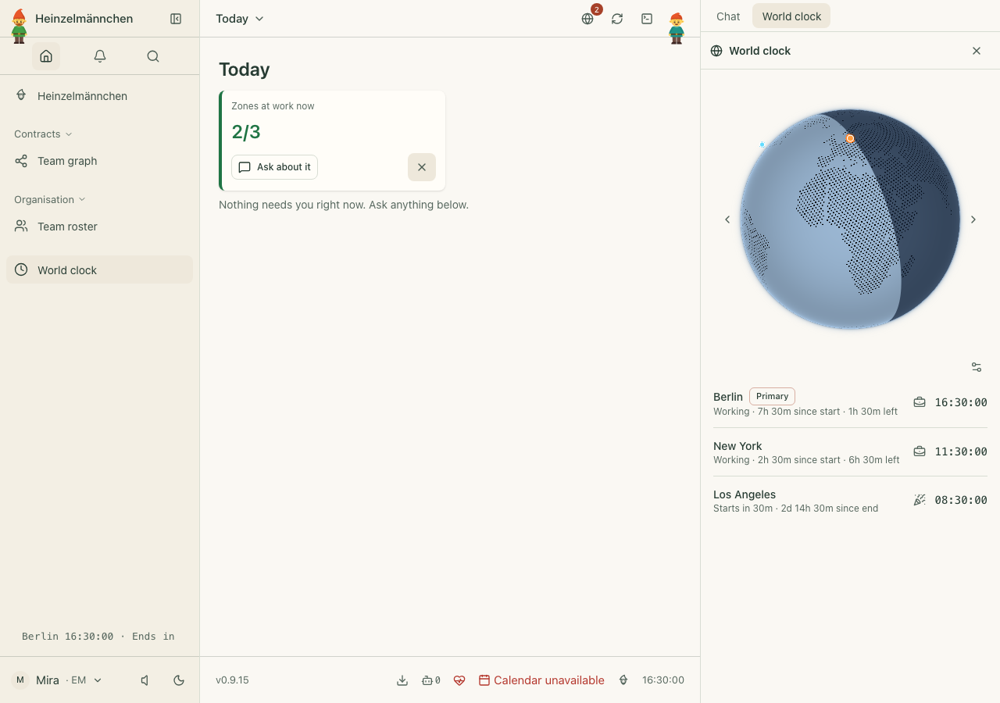
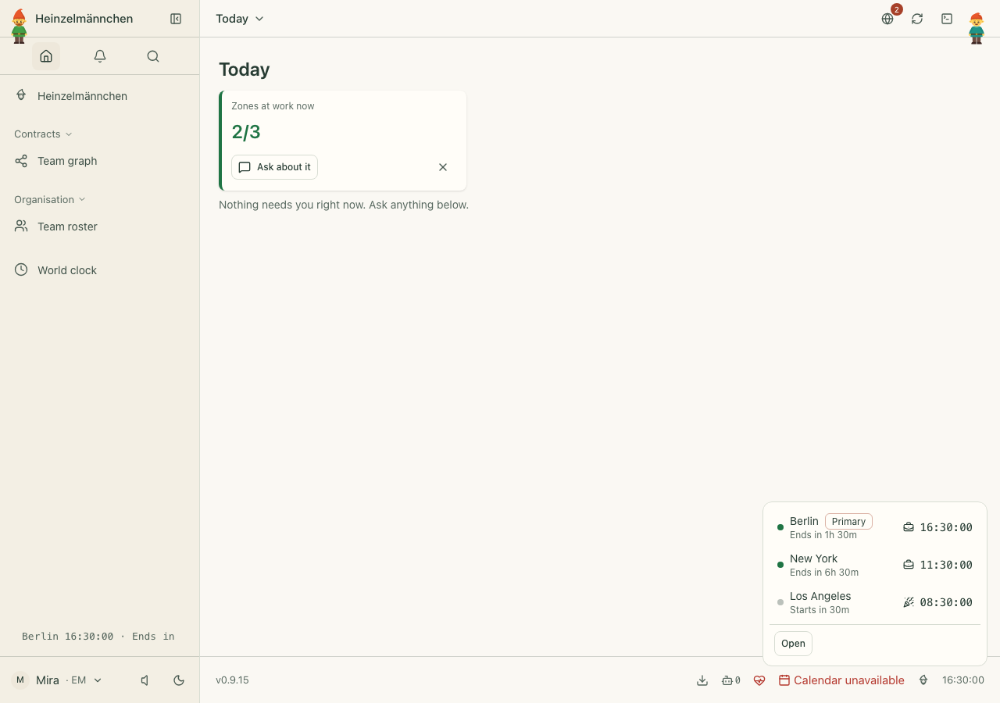
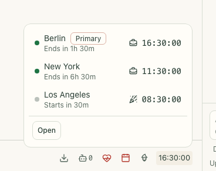
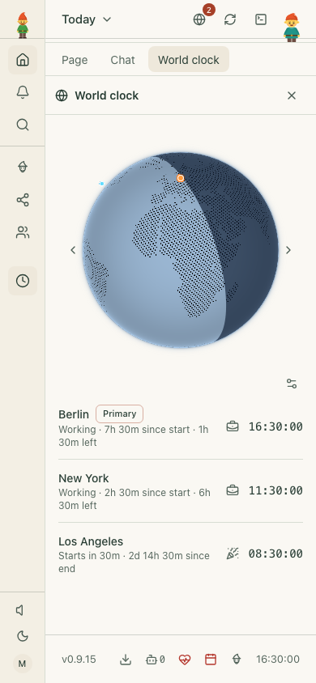
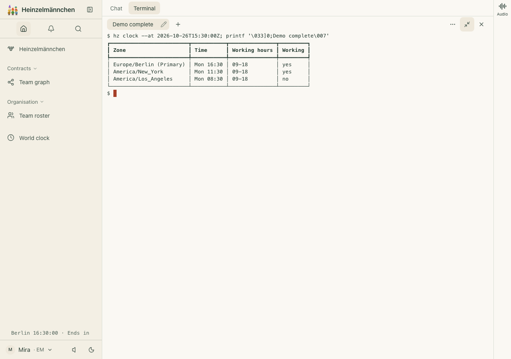
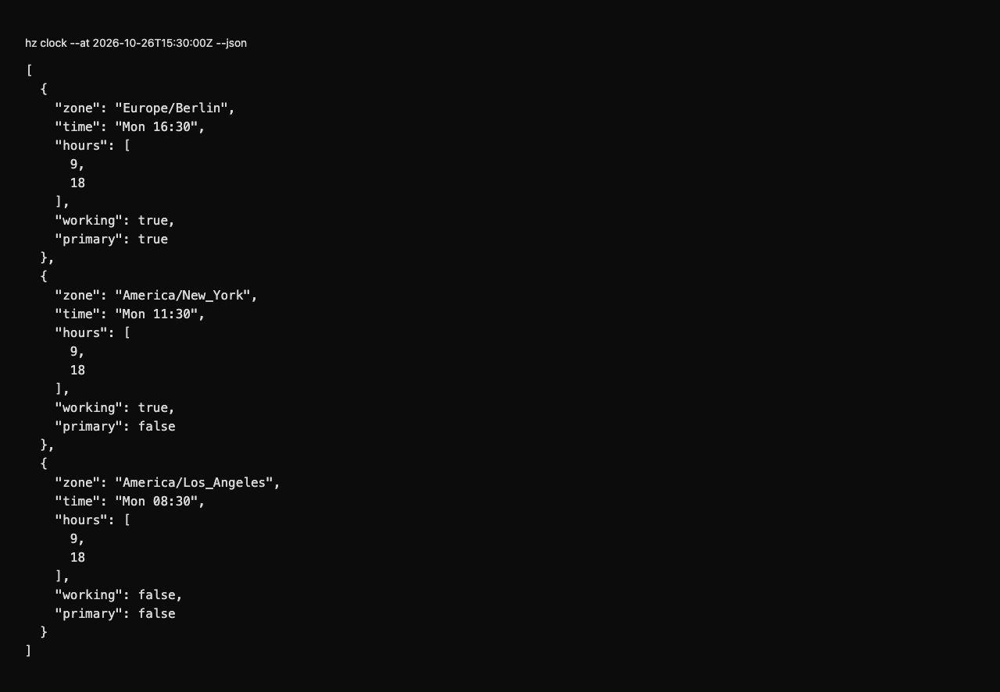

# heinzel-clock: the World Clock

What time it is for everyone on the team: a first-party [Heinzelmännchen](https://github.com/helmut-hoffer-von-ankershoffen/heinzel) plugin with a globe, a sidebar countdown and a footer clock.

Included in the standard app.

```bash
hz setup clock                            # pick the team's time zones and the working hours in each
hz clock                                  # the team's local times; --json for agents
hz system config set clock.zones '[{ name = "Europe/Berlin", hours = [9, 18] }, "America/New_York"]'
```

Each zone is an IANA name, which gets working hours 9 to 18, or a table with its own `hours`. The same operation is
the MCP tool `clock` (`hz system serve mcp`) and `GET /clock` (`hz system serve api`); the zones are checked by
`hz system doctor`, and `hz setup` includes the World Clock's optional setup step.

The settings before per-zone hours (`zones` as names and one `working_hours` for all) are still read, and
`hz system doctor` reports them as degraded. `hz setup clock` rewrites them in the new shape when they are in your
user file; remove `working_hours` from a project `hz.toml` or `HZ_CLOCK__WORKING_HOURS` yourself.

The World Clock sidebar shows each city's workday countdown. Its markers retain bright outlines through night
shading. On hosts that support detail badges, the footer pane also shows the Primary tag and working, sleeping or
off-duty icon; older hosts keep the primary designation as text.

Development and release commands: [repository guide](../../README.md).


The fallback land outline is simplified [Natural Earth land](https://www.naturalearthdata.com/about/terms-of-use/)
(public domain); representative zone points come from IANA's public-domain zone.tab. Bundled frontend dependency
license notices are packaged alongside the built view.

<!-- screenshots:start -->
## Screenshots



Find overlap across Berlin, New York and Los Angeles with the World Clock — fictional demonstration time



Fictional team working hours at a glance: the Today count and the primary footer clock



Inspect all configured time zones from the primary footer clock — fictional demonstration data



The globe and three fictional team clocks on a phone — fixed demonstration time



Terminal output shown in the app, not a feature view: fictional demo team at 15:30 UTC: Berlin and New York are working; Los Angeles starts in 30 minutes.


Terminal output shown in the app, not a feature view: at 16:30 UTC all three fictional demo zones are within working hours.

<details>
<summary>Command line</summary>



Structured clock data for the fictional team at the fixed demonstration time.

</details>

[Open the screenshot gallery](docs/assets/screenshots/index.html).
<!-- screenshots:end -->
