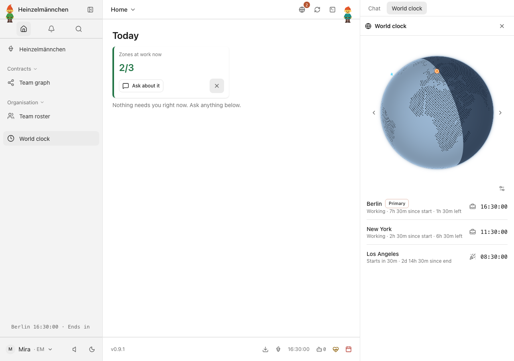
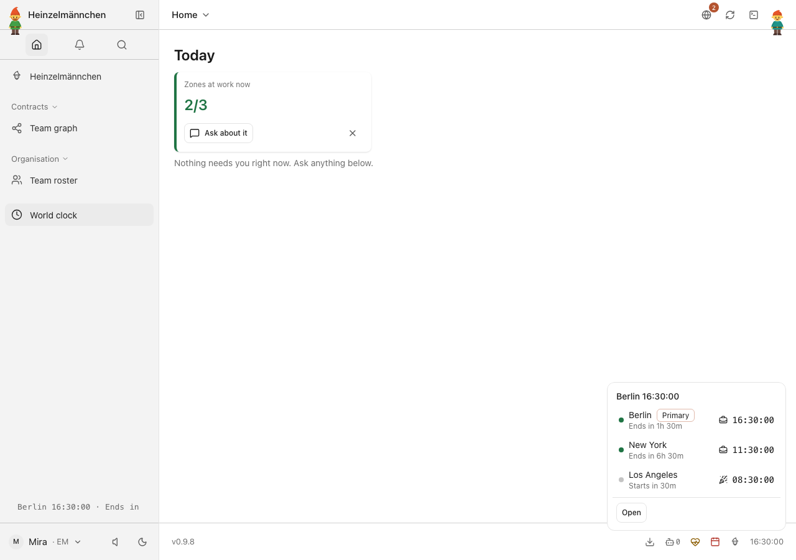
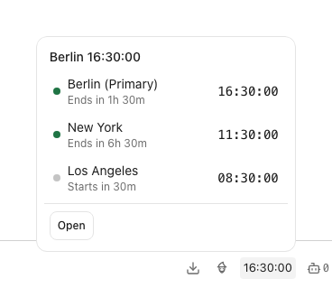
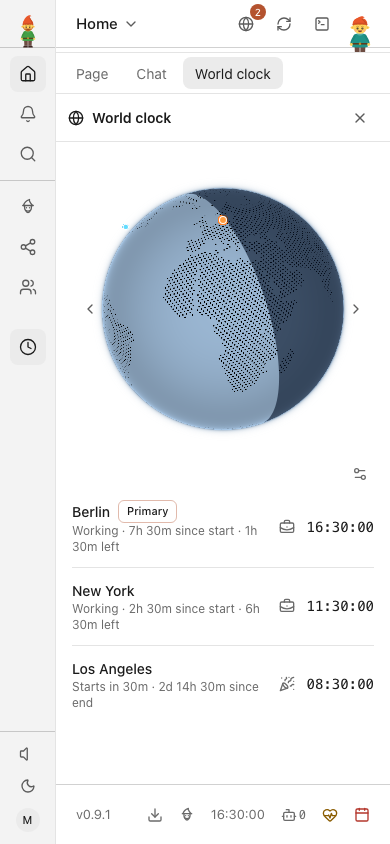
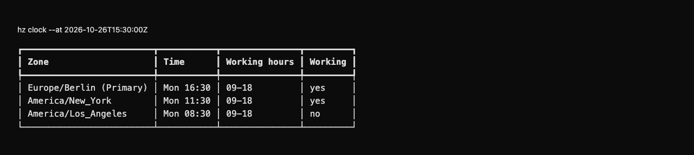

# heinzel-clock: the World Clock

What time it is for everyone on the team — a first-party [Heinzelmännchen](https://github.com/helmut-hoffer-von-ankershoffen/heinzel) plugin, and the smallest
plugin-owned feature: Python declarations, globe, assets and tests live in this project.

```bash
hz system plugin add clock --confirm
hz setup clock                            # pick the team's time zones and the working hours in each
hz clock                                  # the team's local times; --json for agents
hz system config set clock.zones '[{ name = "Europe/Berlin", hours = [9, 18] }, "America/New_York"]'
```

Each zone is an IANA name, which gets working hours 9 to 18, or a table with its own `hours`. The same operation is
the MCP tool `clock` (`hz system serve mcp`) and `GET /clock` (`hz system serve api`); the zones are checked by
`hz system doctor`, and `hz setup` includes the World Clock's optional setup step.

The settings before per-zone hours (`zones` as names and one `working_hours` for all) are still read, and
`hz system doctor` reports them as degraded. `hz setup clock` rewrites them in the new shape when they are in your
user file; remove `working_hours` from a project `hz.toml` or `HZ_CLOCK__WORKING_HOURS` yourself.

The World Clock sidebar shows each city's workday countdown. Its markers retain bright outlines through night
shading. On hosts that support detail badges, the footer pane also shows the Primary tag and working, sleeping or
off-duty icon; older hosts keep the primary designation as text.

Development and release commands: [repository guide](../../README.md).

Migration provenance: heinzel, before the 0.9 plugin-boundary migration.

The fallback land outline is simplified [Natural Earth land](https://www.naturalearthdata.com/about/terms-of-use/)
(public domain); representative zone points come from IANA's public-domain zone.tab. Bundled frontend dependency
license notices are packaged alongside the built view.

<!-- screenshots:start -->
## Screenshots



Find overlap across Berlin, New York and Los Angeles while staying on Today — demonstration time



Team working hours at a glance: Today, sidebar ticker and primary footer clock — demonstration time



Inspect every configured time zone from the primary footer clock — demonstration time



The live globe and all three team clocks on a phone — fixed demonstration time

<details>
<summary>Command line</summary>



The same team zones and working hours in the CLI — fixed fictional demonstration time

</details>

[Open the screenshot gallery](docs/assets/screenshots/index.html).
<!-- screenshots:end -->
