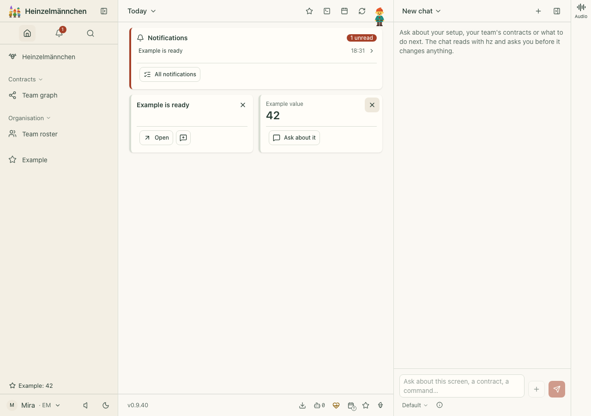
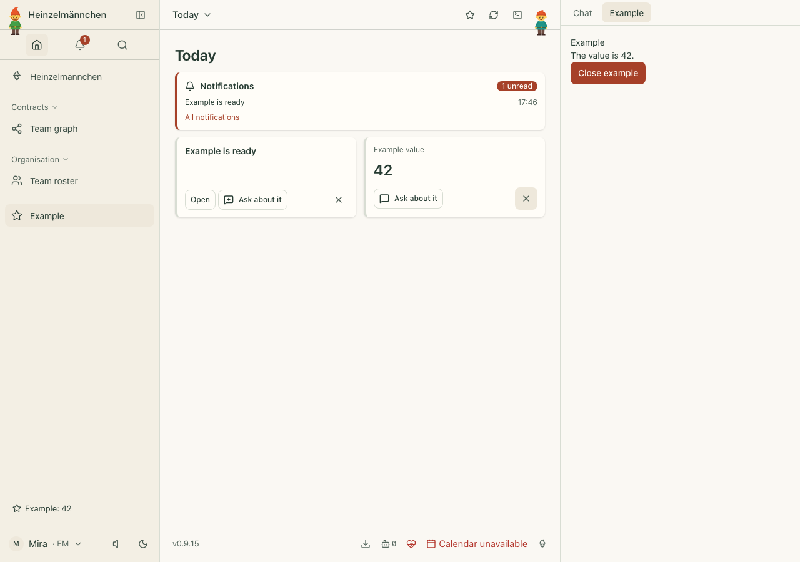
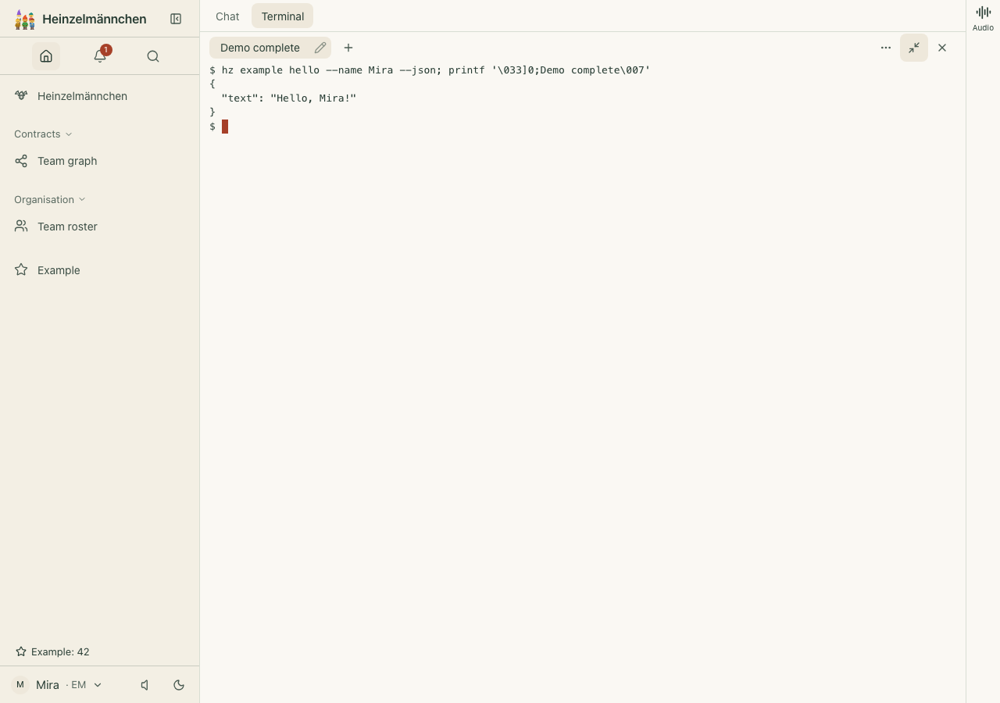
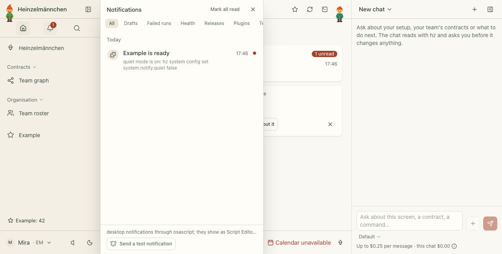
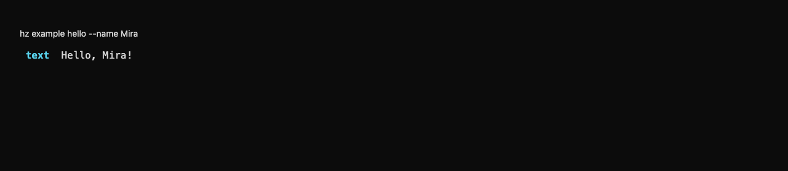
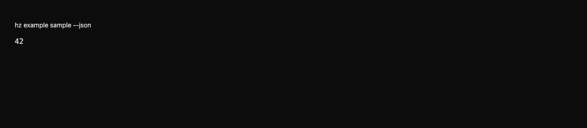

# heinzel-example

Show how a Heinzelmännchen plugin is built: one module with an operation, settings, a health check and a submodule.

A plugin for [Heinzelmännchen](https://github.com/helmut-hoffer-von-ankershoffen/heinzel), the open-source, AI-driven
operating system for product development teams. It lives in
[heinzel-plugins](https://github.com/helmut-hoffer-von-ankershoffen/heinzel-plugins).

## Install

Start Heinzelmännchen with `uvx heinzel@latest`. In another terminal, add this plugin:

```sh
hz system plugin add example --confirm
```

`hz system update` updates the app and its plugins; `hz system plugin remove heinzel-example` removes this one.

## Use

```bash
hz example info                 # this plugin, its version and the Heinzelmännchen it runs on
hz example hello --name Ada     # a submodule collapsed into a command
hz example info --json          # every command speaks JSON, for scripts and agents
hz system info                  # includes a section contributed by this plugin
```

## Develop

From the repository root: `make check-fast NAME=example` runs this plugin's edit loop; `make check NAME=example`
runs its full checks. `make build NAME=example` and `make acceptance NAME=example` verify its installed artifact.
The modules live in
`src/heinzel_example/`; read the root [AGENTS.md](../../AGENTS.md) before changing them.

## Footer pane

The example is also the teaching example for a footer icon that opens a pane. Three contributions in
`src/heinzel_example/__init__.py` do it, with no core change:

- `@module.status(source="sample", slots={"footer": True, "sidebar": True})` returns a `StatusItem` with an `icon`, a
  `detail` line (the tooltip, "Example") and `effect=Navigate(path="/?panel=example:inspector")`, the click target.
- `module.view(..., name="inspector", title="Example", source="sample")` is the pane that target opens; its
  `views/index.js` shows the value (42, the same `sample` operation as the Today widget) big. A pane is content, then a
  divider and a bottom action row only when it has actions; this one has none.
- `tests/contributions_test.py` asserts the slots, icon, tooltip, target and view.

Development and release commands: [repository guide](../../README.md).


<!-- screenshots:start -->
## Screenshots



Demo data: the constant 42 appears in both the Today widget and sidebar status.



Demo data: open the plugin-owned inspector to see the same constant value, 42.



Demo data: greet fictional Mira with structured JSON in the app&#x27;s native terminal.



Demo data: a seeded Example is ready notice appears in the shared in-app notification panel.

<details>
<summary>Command line</summary>



Demo data: the typed hello operation greets fictional Mira from the CLI.



Demo data: sample returns 42 as JSON, the same constant used by the widget, status and inspector.

</details>

[Open the screenshot gallery](docs/assets/screenshots/index.html).
<!-- screenshots:end -->
