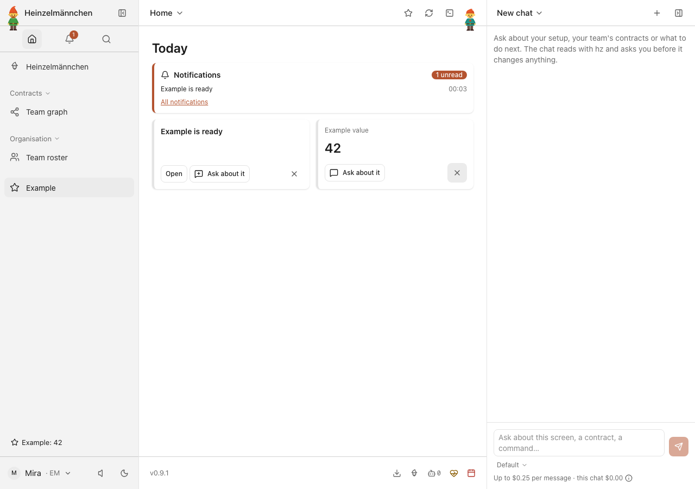
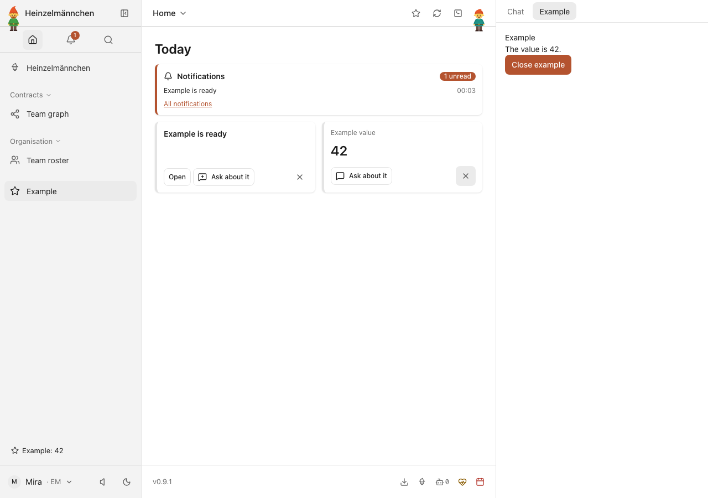
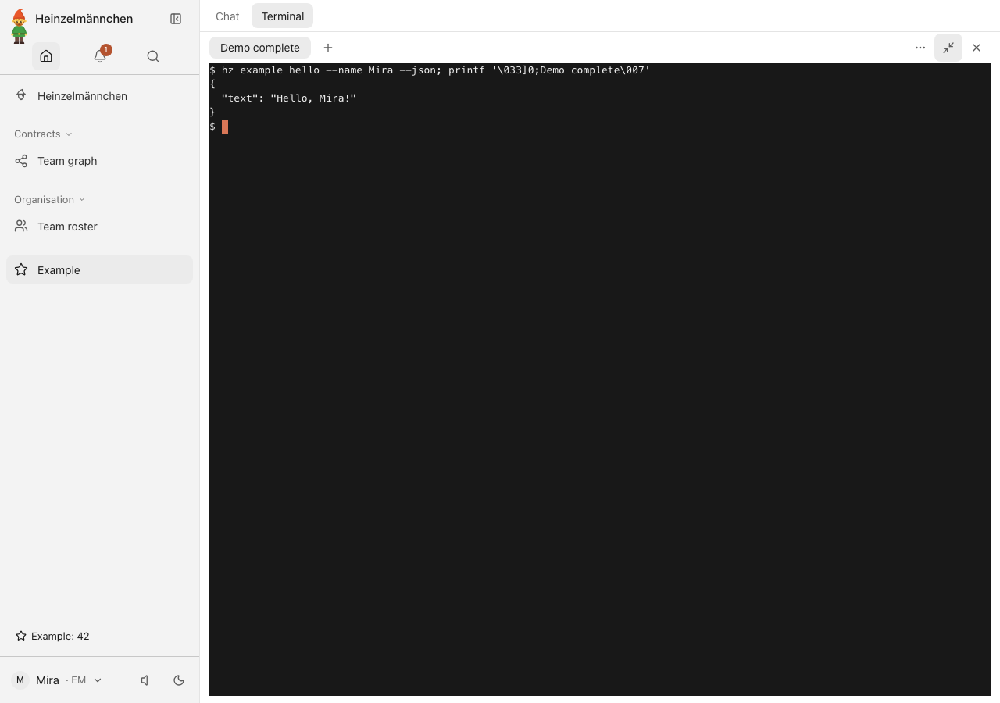
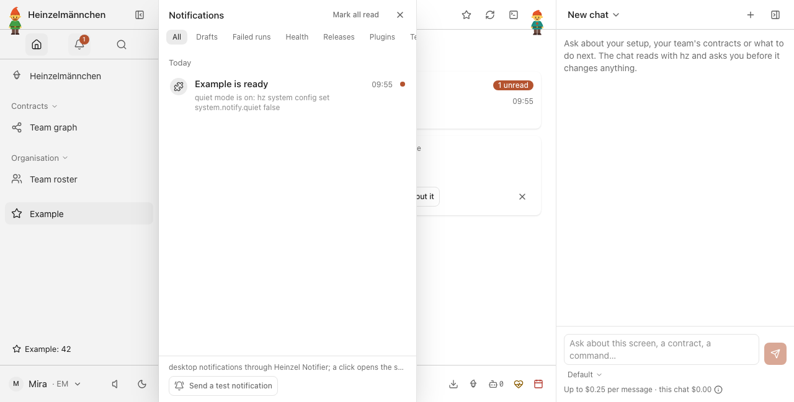
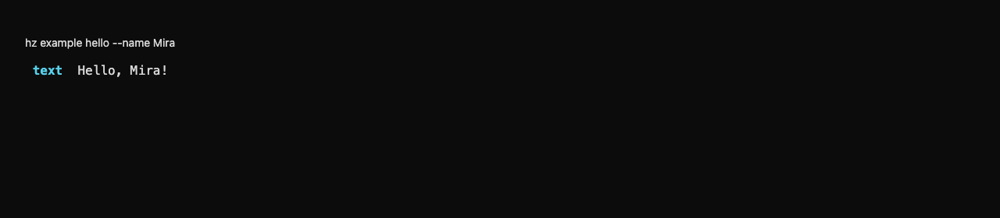
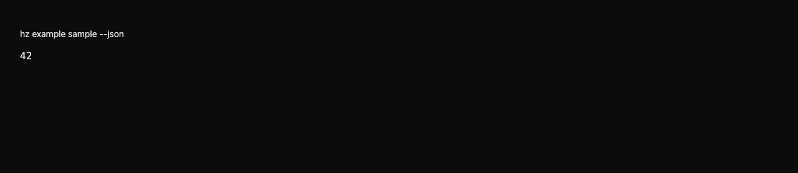

# heinzel-example

Show how a Heinzelmännchen plugin is built: one module with an operation, settings, a health check and a submodule.

A plugin for [Heinzelmännchen](https://github.com/helmut-hoffer-von-ankershoffen/heinzel), the open-source, AI-driven
operating system for product development teams. It lives in
[heinzel-plugins](https://github.com/helmut-hoffer-von-ankershoffen/heinzel-plugins). Its earlier history is preserved
in heinzel-contrib and the archived heinzel-example repository.

## Install

Start Heinzelmännchen with `uvx heinzel@latest`. In another terminal, add this optional plugin:

```sh
hz system plugin add example --confirm
```

The catalog resolves its compatible project metadata automatically. Use `hz system update` to update the app and
compatible plugins; `hz system plugin remove heinzel-example` removes this plugin.

## Use

```bash
hz example info                 # this plugin, its version and the Heinzelmännchen it runs on
hz example hello --name Ada     # a submodule collapsed into a command
hz example info --json          # every command speaks JSON, for scripts and agents
hz system info                  # includes a section contributed by this plugin
```

## Develop

From the repository root: `make check-fast NAME=example` runs this plugin's edit loop; `make check NAME=example`
runs its full checks. `make build NAME=example` and `make acceptance NAME=example` verify its installed artifact.
The modules live in
`src/heinzel_example/`; read the root [AGENTS.md](../../AGENTS.md) before changing them.

Development and release commands: [repository guide](../../README.md).

Migration provenance: heinzel-contrib, before the 0.9 plugin-boundary migration.

<!-- screenshots:start -->
## Screenshots



One tiny plugin contributes a Today widget and sidebar status from the same value



Open the plugin-owned inspector and read the same value 42



The same typed greeting as structured output in the real app terminal



A plugin notice in the shared in-app notification panel — isolated demonstration

<details>
<summary>Command line</summary>



A typed plugin operation greets Mira from the CLI



The typed value behind the widget, status and inspector

</details>

[Open the screenshot gallery](docs/assets/screenshots/index.html).
<!-- screenshots:end -->
