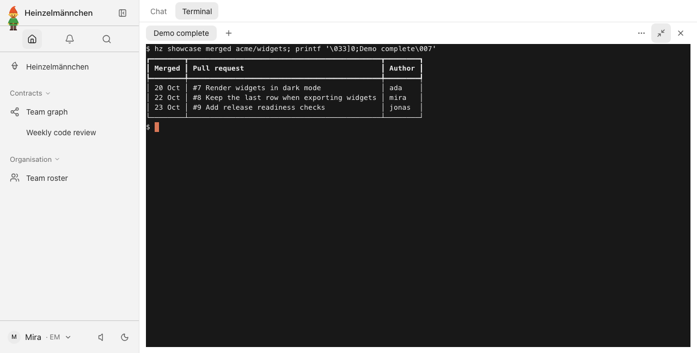
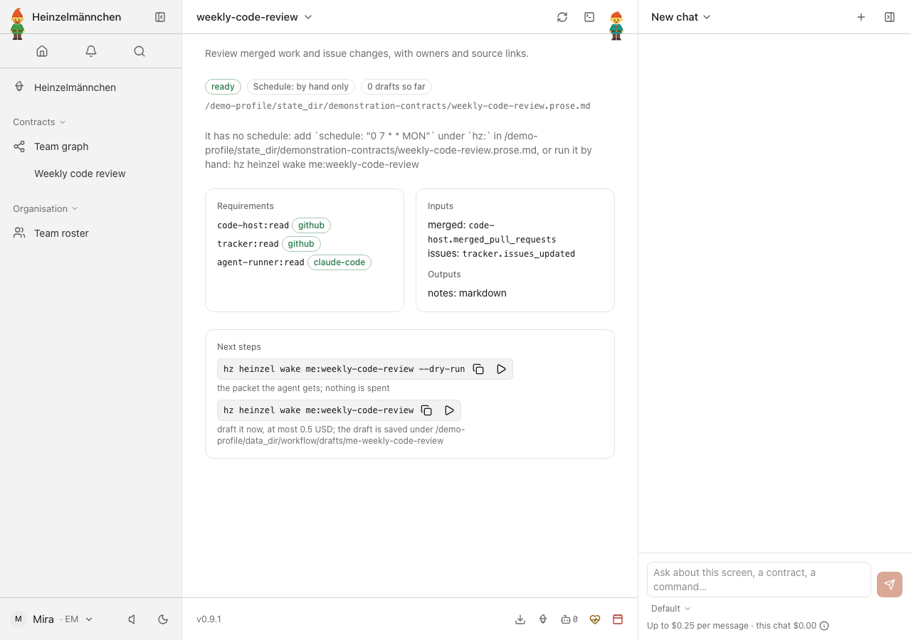
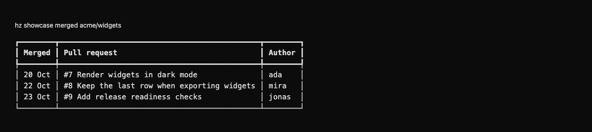
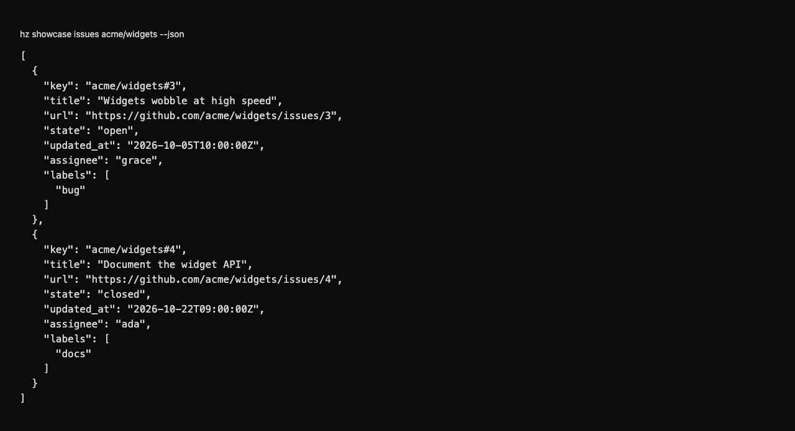

# heinzel-github

Read pull requests and issues from GitHub, the `code-host` and `tracker` capabilities ([ADR 0028](https://github.com/helmut-hoffer-von-ankershoffen/heinzel/blob/main/docs/adr/0028-integrations-are-capability-adapters.md)): a first-party
[Heinzelmännchen](https://github.com/helmut-hoffer-von-ankershoffen/heinzel) plugin. It is independently released and installed explicitly:

```bash
hz system plugin add github --confirm             # a compatible plugin release; run it again to upgrade
hz system plugin remove heinzel-github
```

## Set up

The adapter talks to GitHub only through the [GitHub CLI](https://cli.github.com) `gh` (2.40.0 or later), which owns
authentication ([ADR 0035](https://github.com/helmut-hoffer-von-ankershoffen/heinzel/blob/main/docs/adr/0035-integrations-go-through-vendor-clis-as-an-ordinary-employee.md)). It reads what you can read, as you:
no app to register, no token to create or store. Install `gh` and log in once:

```bash
gh auth login                           # or: gh auth login --hostname ghe.example.com
```

The adapter acts with whatever that login may do, which is usually more than reading; it only ever sends GET
requests. As for any `gh` command, a `GH_TOKEN` or `GITHUB_TOKEN` (`GH_ENTERPRISE_TOKEN` for a GitHub Enterprise
Server) in your environment takes precedence over the stored login: it is gh's own variable, passed to gh and never
read by Heinzelmännchen. If you stored a token for an earlier version, remove it:
`hz system credential remove github-token --service github` (or unset `HZ_CREDENTIAL_GITHUB_GITHUB_TOKEN`).

Bind the adapter in your user configuration, never in a project `hz.toml`, which Heinzelmännchen ignores for bindings:

```bash
hz system config set capabilities.code_host github
hz system config set capabilities.tracker github
```

which writes

```toml
[capabilities]
code_host = "github"
tracker = "github"
```

Or per shell: `HZ_CAPABILITIES__CODE_HOST=github`, `HZ_CAPABILITIES__TRACKER=github`.

For GitHub Enterprise Server, name its host in your user configuration or `HZ_GITHUB__HOST`; the adapter passes it to
`gh` as `--hostname` and `GH_HOST`, so `gh` uses its login for that host:

```bash
hz system config set github.host ghe.example.com
```

or in the file (`api_url` from earlier versions is refused; `host` replaced it):

```toml
[github]
host = "ghe.example.com"
gh = "gh"      # the GitHub CLI: a name on PATH (absolute entries only) or an absolute path
timeout = 60   # seconds per gh call
```

`host`, `gh` and `timeout` are ignored in a project `hz.toml`, so a repository can't send your login elsewhere or pick
the program that runs. The adapter's hosts come
from it: `hz system capability list` shows `api.github.com`, or your GitHub Enterprise Server's host.

### Is it connected?

Bound automatically while it is the only installed adapter of a capability (usually `code-host`; `tracker` once another
tracker is installed needs a choice), [ADR
0055](https://github.com/helmut-hoffer-von-ankershoffen/heinzel/blob/main/docs/adr/0055-connectors-show-their-sign-in-test-live-on-demand-and-bind-themselves-when-alone.md). `hz
system connector list` (or Settings → Connectors in `hz ui`) shows whether `gh` is logged in and as whom, read from gh's
hosts file without asking GitHub; `hz system connector test github` asks GitHub who gh is (`gh api user`, 15 s at most),
and only when you run it.

## Use

Workflows ask for `code-host` and `tracker`, never for GitHub:

```python
from datetime import datetime

from heinzel import CodeHost, Module, PullRequest, Window

module = Module("digest", "Weekly digest.", requires=["code-host:read", "tracker:read"])


@module.operation
def merged(code_host: CodeHost, since: datetime, until: datetime) -> list[PullRequest]:
    """Pull requests merged this week."""
    return code_host.merged_pull_requests("acme/widgets", Window(since=since, until=until))
```

| Method | Capability | `gh api` call |
| --- | --- | --- |
| `merged_pull_requests(repository, window)` | `code-host:read` | `repos/{owner}/{repo}/pulls?state=closed&sort=updated&direction=desc`, kept when `merged_at` is in the window; paging stops before the window |
| `issues_updated(project, window)` | `tracker:read` | `repos/{owner}/{repo}/issues?state=all&since=...&sort=updated&direction=asc`, without pull requests |

Repositories and projects are written `owner/repo`; windows are half-open `[since, until)` with timezone-aware times;
results are oldest first. The adapter pages with the API's `page` and `per_page` parameters rather than
`gh api --paginate`, so it can stop as soon as the window is covered. A call reads at most 100 pages of 100 (10,000
items), 50 MiB in all and ten times `github.timeout`, then fails and says what to ask for instead: merged pull requests page through every pull request updated since `since`, even after `until`, so they need
a window that starts more recently; issues stop at `until`, so they need a shorter window. Why the pulls list and not
the search API: [ADR 0033](https://github.com/helmut-hoffer-von-ankershoffen/heinzel/blob/main/docs/adr/0033-github-rest-api-over-urllib.md); why `gh`:
[ADR 0035](https://github.com/helmut-hoffer-von-ankershoffen/heinzel/blob/main/docs/adr/0035-integrations-go-through-vendor-clis-as-an-ordinary-employee.md).

```bash
hz github info                  # this plugin, its version and the GitHub host it reads
hz system capability list       # who reads what, through which adapter and hosts
hz system doctor                # gh on PATH, its version and login, the bindings; never contacts GitHub
```

Errors say what to do: no `gh`, or one too old, names where to get it; no login, or a login GitHub rejects, names
`gh auth login --hostname <host>`; a rate limit says to wait and how to see when it resets; a missing or forbidden
repository says to check the spelling and what your account can see; a slow call names the timeout setting.

How `gh` is run: with an argument list, never a shell, from your home directory, in its own process group, stopped
(SIGTERM, then SIGKILL) at the timeout, with its output capped, and with an allowlisted environment: never
Heinzelmännchen's `HZ_CREDENTIAL_*` variables or debug switches such as `GH_DEBUG`, which would print request
headers. Doctor runs only `gh --version` and looks for the host in gh's hosts file (or a token variable gh reads); it
never runs a command that prints a token. Everything GitHub or `gh` says is redacted of anything shaped like a GitHub
token, stripped of control and bidirectional characters, and only then cut to length; every string the adapter
returns is cleaned too.

Development and release commands: [repository guide](../../README.md).

Migration provenance: heinzel, before the 0.9 plugin-boundary migration.

<!-- screenshots:start -->
## Screenshots



Merged pull requests in the app terminal — fixture-only requester, real GitHub adapter


Issue changes, owners and states in the app terminal — fictional GitHub repository



Weekly code review combines the declared source inputs — local demonstration, no report generated

<details>
<summary>Command line</summary>



Read merged work in the shell — fixture-only requester, real GitHub adapter



Typed issue results for scripts and agents — fixture-only requester, fictional GitHub data

</details>

[Open the screenshot gallery](docs/assets/screenshots/index.html).
<!-- screenshots:end -->
