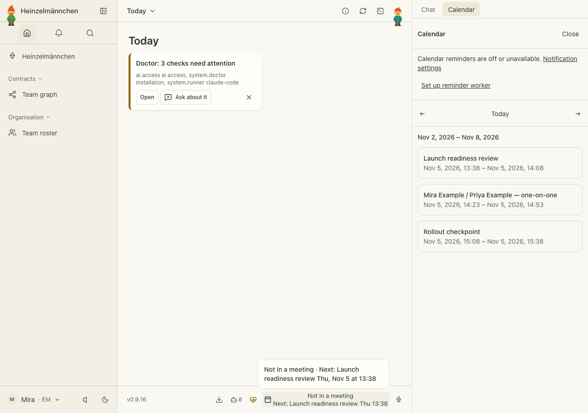
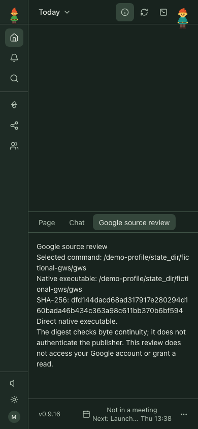
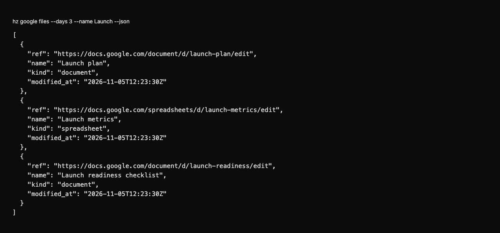
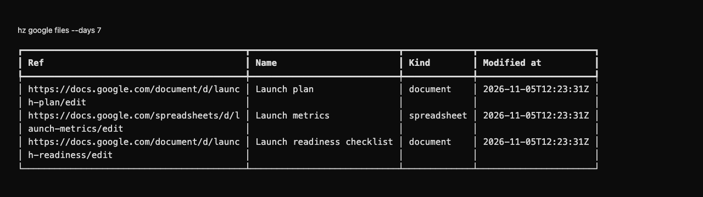
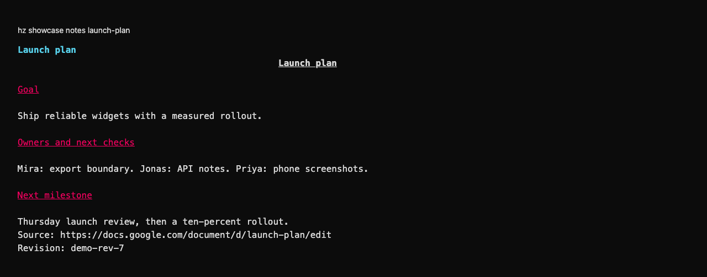
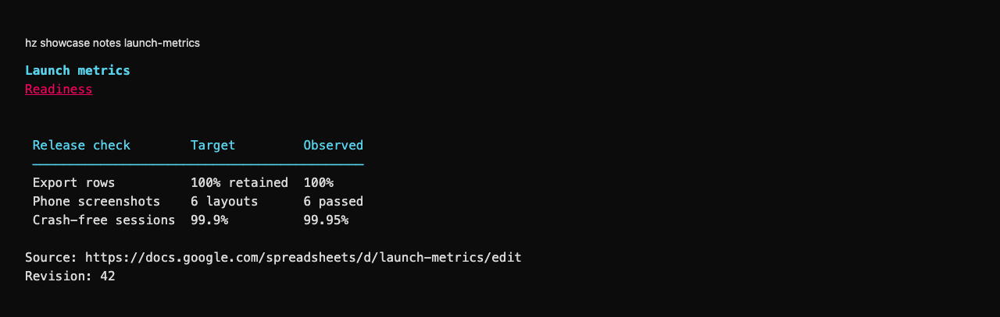
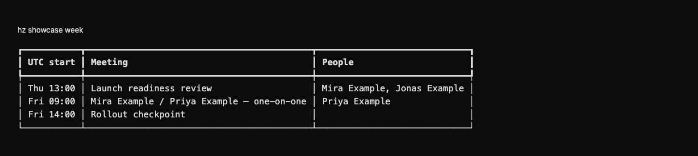
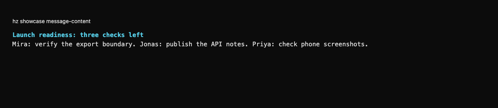

# heinzel-google

Google Docs, Sheets, Slides, Drive, Calendar and Gmail: the `documents` (read), `calendar` and `mail` (read and write)
capabilities ([ADR 0028](https://github.com/helmut-hoffer-von-ankershoffen/heinzel/blob/main/docs/adr/0028-integrations-are-capability-adapters.md)): a first-party
[Heinzelmännchen](https://github.com/helmut-hoffer-von-ankershoffen/heinzel) plugin.

Install it with:

```bash
hz system plugin add google --confirm
hz system plugin remove heinzel-google
```

It is the **default provider** for Google Workspace, not the only possible one: workflows ask for `documents`,
`calendar` and `mail`, and any other plugin that provides those capabilities can be bound instead, in configuration.

## How it reaches Google

Through the open-source [Google Workspace CLI](https://github.com/googleworkspace/cli), `gws` (0.22 or newer): it
signs in with Google, keeps its own credentials (encrypted, with the key in the OS keychain, by default) and calls
Google's APIs. Ordinary capability commands leave tokens to `gws`; source-bound leases obtain service-scoped
OAuth credentials through an isolated helper, without including credentials in captured content or diagnostics.
It runs `gws <service> <resource> <method> --params <JSON> --format
json` as an argument list (never through a shell), with the executable resolved to an absolute path, from the root
directory (so no project's `.env` reaches `gws`), with an allowlisted environment (never Heinzelmännchen's own
credentials or other secrets; of gws's own variables only `GOOGLE_WORKSPACE_CLI_CONFIG_DIR`, `_KEYRING_BACKEND`,
`_CLIENT_ID`, `_CLIENT_SECRET` and `GOOGLE_WORKSPACE_PROJECT_ID`, not its token, credentials-file, sanitizing or log
variables), a
timeout that stops `gws` and anything it started, and at most 10 MB of output read. Why `gws`:
[ADR 0042](https://github.com/helmut-hoffer-von-ankershoffen/heinzel/blob/main/docs/adr/0042-google-workspace-through-the-gws-cli.md).

What leaves this machine, and where to: file ids, the Drive query (the modified-time window and the `--name` text)
the calendar window and the mail search, to Google's API hosts (`www.googleapis.com` for Drive and Calendar,
`docs.googleapis.com`, `sheets.googleapis.com`, `slides.googleapis.com`, `gmail.googleapis.com`); `gws` also fetches API descriptions from Google and refreshes its sign-in at
`oauth2.googleapis.com`. Nothing goes anywhere else: gws 0.22 documents no telemetry or update check, and none was
found in it.

## Set up

Install `gws` (it needs Node.js), give it an OAuth client once (`gws auth setup`, which needs `gcloud`, or a Desktop
OAuth client as its README describes), then let setup do the rest:

```bash
npm install -g @googleworkspace/cli
hz setup google         # finds gws, signs it in, binds documents, calendar and (if you say so) mail
hz system doctor        # finds gws, checks its version and its stored sign-in, from files; Google isn't contacted
```

By hand, setup is:

```bash
gws auth login --scopes https://www.googleapis.com/auth/documents.readonly,https://www.googleapis.com/auth/spreadsheets.readonly,https://www.googleapis.com/auth/presentations.readonly,https://www.googleapis.com/auth/drive.metadata.readonly,https://www.googleapis.com/auth/calendar.readonly
hz system config set capabilities.documents google
hz system config set capabilities.calendar google
```

Version 0.9.2 adds the read-only Slides permission, `https://www.googleapis.com/auth/presentations.readonly`,
for the existing presentation reader. It permits reading presentations the account can access, not just one
selected deck ([Google API contract](https://developers.google.com/workspace/slides/api/reference/rest/v1/presentations/get)).
An upgrade or a stored sign-in does not grant that permission. Existing users who choose Slides reads must
explicitly consent with the login command above; `hz setup google` may return without signing in again when
already configured. `gws auth login` replaces its scope list: include any existing opt-in Gmail, Calendar or
write scopes you intend to retain. This plugin never silently signs in again to add Slides permission.

Mail is opt-in: setup asks, defaulting to no, and then signs in again with Gmail's read-only scope added
(`,https://www.googleapis.com/auth/gmail.readonly`), which lets the plugin read all of your mail; then
`hz system config set capabilities.mail google`.

Writes are opt-in too. Setup asks whether hz may change your calendar and your mail, defaulting to no; only then does
the sign-in ask for `https://www.googleapis.com/auth/calendar.events` (create, move, cancel and answer events) and
`https://www.googleapis.com/auth/gmail.modify` (keep drafts, send them, file conversations; it reads too, so it
replaces `gmail.readonly`, and it can't delete mail for good). Heinzelmännchen writes only from confirmed write operations
that show you what they will do and run after you confirm; your Heinzel only proposes them
([ADR 0059](https://github.com/helmut-hoffer-von-ankershoffen/heinzel/blob/main/docs/adr/0059-the-calendar-and-the-mail-write-through-hz-after-a-confirmation.md)). Without the
scope, a write fails with the `gws auth login` that adds it.

These are the narrowest read-only scopes for what the adapters do; `drive.metadata.readonly` lists and identifies files
and never reads their contents (Google classes it as restricted, which matters only for published OAuth clients).
Bindings go in your user configuration, never in a project `hz.toml`, which Heinzelmännchen ignores for them.

Optional settings, in `[google]` or `HZ_GOOGLE__<FIELD>`: `gws_path`, the absolute path of `gws` when it isn't on
`PATH` (only absolute `PATH` entries are searched; both are ignored in a project `hz.toml`: a repository someone else
controls must not choose the program that reads your data), and `timeout`, the seconds each `gws` run may take
(default 60, also ignored in a project `hz.toml`).

### Is it connected?

Bound automatically to documents and calendar while it is the only installed adapter of them, [ADR
0055](https://github.com/helmut-hoffer-von-ankershoffen/heinzel/blob/main/docs/adr/0055-connectors-show-their-sign-in-test-live-on-demand-and-bind-themselves-when-alone.md); mail
never is, so Gmail stays opt-in: `hz setup google` asks. `hz system connector
list` shows whether gws has a sign-in, from its files alone; `hz system connector
test google` asks Drive who is signed in (`gws drive about get`, 15 s at most), and only when you run it.

## Use

Workflows ask for `documents` and `calendar`, never for Google:

```python
from pydantic import AwareDatetime

from heinzel import Calendar, Document, Documents, Event, Module, Window

module = Module("prep", "One-on-one preparation.", requires=["documents:read", "calendar:read"])


@module.operation
def week(calendar: Calendar, since: AwareDatetime, until: AwareDatetime) -> list[Event]:
    """This week's events."""
    return calendar.events(Window(since=since, until=until))


@module.operation
def notes(documents: Documents) -> Document:
    """The running notes, as Markdown."""
    return documents.read("https://docs.google.com/document/d/1AbCdEfGhIjKlMnOpQrStUvWxYz/edit")
```

| Method | Capability | `gws` command |
| --- | --- | --- |
| `read(ref)` | `documents:read` | `drive files get` (metadata), then `docs documents get` with `includeTabsContent`, `sheets spreadsheets get` with `includeGridData`, or `slides presentations get` |
| `events(window)` | `calendar:read` | `calendar events list` on `primary`, `singleEvents`, `showDeleted`, paged by `pageToken` |
| `messages(query, window)` | `mail:read` | `gmail users messages list` with Gmail's search, then `messages get` (metadata) for each |
| `read(message)` | `mail:read` | `gmail users messages get` (full) |
| `free_busy(people, window)` | `calendar:read` | `calendar freebusy query` for `primary` and each address |
| `create_event(event)` | `calendar:write` | `calendar events insert` on `primary` with an id of hz's own (no duplicate on a retry), `sendUpdates` as the draft says, a Meet link when asked |
| `update_event(event, change)` | `calendar:write` | `calendar events get`, then `patch` (only your events, or ones whose guests may change them) |
| `cancel_event(event, notify)` | `calendar:write` | `calendar events get`, then `delete` (only your events; decline others') |
| `respond(event, response)` | `calendar:write` | `calendar events get`, then `patch` of your own attendee entry |
| `thread(thread)` | `mail:read` | `gmail users threads get` (full), without drafts, Spam and Trash |
| `draft(draft)` | `mail:read` | `gmail users drafts get` (full) |
| `create_draft(draft)` | `mail:write` | `gmail users drafts create` with a plain-text MIME message; a reply with `threadId`, `In-Reply-To` and `References` |
| `send_draft(draft, seen)` | `mail:write` | `gmail users drafts get`, then `send` if its message is still the one you saw |
| `relabel(thread, add, remove)` | `mail:write` | `gmail users threads modify` with label ids; not Spam, Trash, Drafts or Sent |

- **Documents** are a Docs, Sheets or Drive link (`https://docs.google.com/document/d/<id>/...`,
  `.../spreadsheets/d/<id>/...`, `https://drive.google.com/file/d/<id>/...`, `.../open?id=<id>`) or a bare file id;
  links to any other host are refused before `gws` runs, and a Drive shortcut is followed once. A Doc comes back as
  Markdown-flavoured text, every tab under its title: headings, lists, bold and italic, links, tables; person chips by
  name, never their email, and mail links by their text; titles and link targets can't start a line of their own;
  images and drawings are left out. A Sheet comes back as one `## <sheet>` table per sheet
  with the values as people see them. `revision` is the Doc's revision id or the Sheet's Drive version. Uploaded Word
  or Excel files are refused: open them as a Google Doc or Sheet first.
- **Events** are your primary calendar's, every occurrence of a recurring event, cancelled ones included, by start.
  Attendees are display names and emails, without meeting rooms; the workflow packet builder drops the emails before
  anything reaches an agent's prompt. `conference_id` is the Zoom meeting number when the event has a Zoom link (in
  its conferencing data, location or description), else the Meet code, so the `meetings` capability can find the
  event's meeting; conference links are kept only on the conferencing services' own hosts (Meet, Zoom, Teams, Webex),
  without their query, where passcodes live. A display name that is an address is dropped.
- **Mail** is your Gmail: `messages` takes the shared query syntax (`from:<address or domain> subject:<text>
  label:<name>`) and a window. The window and the sender go into Gmail's search and the label as its id; the subject
  is matched by the plugin, because Gmail's `subject:` matches whole words only. Results come oldest first, at most
  200 messages a window (one `gws` run each). `read` gives the text part, or the HTML part as text, in the part's own
  charset, without attachments, and only the headers that carry no addresses. Senders and recipients are names and
  emails, parsed before any encoded name is decoded, so a display name can't pose as an address; the workflow packet
  builder drops the addresses before anything reaches an agent's prompt. A message longer than 2 million characters,
  or with more than 500 MIME parts or 2 million characters of HTML, is refused, not cut; Spam and Trash are not
  read; reading one window's messages may take at most five minutes.
- **Writes** change only what the person confirmed, through confirmed write operations. Ids are checked before they reach
  `gws`; a write that times out or fails without Google refusing it is not retried and says to look in Google first;
  a rate-limited one is retried. A recurring series' own id is refused: one occurrence changes at a time. Drafts are built with
  Python's `email` package from plain addresses and one-line subjects, so nothing can add a header.
- **Text is data.** Every string returned passes `heinzel.clean_text` (no control, invisible or bidirectional
  characters).
- **Bounds.** One `gws` run prints at most 10 MB, one call reads at most 100 pages or 25 MB, a Doc's text at most four
  times its JSON, tables and tabs nest at most 8 deep, a Sheet at most a million cells; past that, an error says to
  narrow the window or that the file is too large. Rate limits are honoured: a rate-limited call is retried after 1, 2
  and 4 seconds, then fails saying when to retry.

```bash
hz google info                  # this plugin, its version, the gws it uses, the scopes and APIs
hz google files --days 3        # Docs and Sheets you can open that changed in the last three days
hz system capability list       # who reads what, through which adapter and hosts
```

Errors say what to do: no `gws` names the install; not signed in or an expired sign-in names the exact
`gws auth login` command above (doctor names `hz setup google`); a missing scope or a disabled API says which; a file the account can't see says so.
Token-shaped strings in anything `gws` says are redacted before it is shortened.

Development and release commands: [repository guide](../../README.md).


<!-- screenshots:start -->
## Screenshots



The real Core calendar reads a fictional launch week through the Google adapter; no Google account is contacted.



Inspect a fictional selected-source identity on a phone; its real digest is continuity evidence, not a login or publisher check.

<details>
<summary>Command line</summary>



Inspect a three-day launch-file query as structured data — actual Google operation, fictional Workspace replies.



Try a seven-day file query — fictional replies demonstrate invocation, not verified server-side filtering.



Read a fictional Google Doc as useful text through the real adapter and a fixture-only requester.



Read a fictional Sheet as a table through the real adapter and a fixture-only requester.



Read the fixed fictional October launch week; the separate current-window UI uses the same fixture provider.



Read a fictional launch message through the real Gmail adapter and a fixture-only requester.

</details>

[Open the screenshot gallery](docs/assets/screenshots/index.html).
<!-- screenshots:end -->

### Captured reads and reviewed writes

Version 0.9.2 requires published Heinzel 0.9.16 for source-bound reads, captured writes and marked draft appends.
The provider source is being prepared against that published SDK; this is not real-account or workflow acceptance.
The captured-write adapter implements existing Docs and Slides with Google's `requiredRevisionId` precondition.
Sheets append and new-file creation are refused by this captured-write contract because they cannot enforce
that revision atomically. Their implementation helpers remain pending a suitable host contract.
A failed or uncertain mutation cannot be replayed through the same lease. An acknowledgement carries no
revision inferred from a later read. No real Google account, sign-in, or provider write was used to validate
this candidate, and the Turing rolling-document workflow remains unaccepted.

For captured writes, `insert-draft` into a Doc appends at `section="end"` or inserts after the first paragraph
matching the section text. A URL's `tab` query or fragment selects that exact tab, including nested tabs;
the adapter reads with `includeTabsContent`, passes `tabId` inside the insertion location and uses the reviewed
`requiredRevisionId`. It checks the same tab after mutation without treating that later read as an acknowledgement
revision. A missing tab or heading is refused during draft review. Slides currently implements only
`section="end"`, meaning a new slide with the draft text. Existing slide/shape sections are refused before
credential capture and approval; editing those sections remains pending, alongside Sheets and new-file support.

Subprocess deadlines still stop useful work at the original timeout. If killing, reaping, or confirming the
owned process group is uncertain, cleanup retains the caller and credential lease lock until termination is
confirmed. It does not return an ordinary read/write failure or release the credential while that work may run.
The tab and process behavior is covered only with offline provider models and owned local test subprocesses.
Provider reference: [Docs tab locations and defaults](https://developers.google.com/workspace/docs/api/reference/rest/v1/documents/request)
and [reading tab content](https://developers.google.com/workspace/docs/api/how-tos/tabs).

Installed registration keeps the legacy `documents` capability read-only: its public write contract requires
`replace_section`, which this insert-draft adapter does not implement. The separate `CapturedWriteService` is
registered and resolves through the real host source capture, with the private proposal/execution operations
still requiring their existing approval and credential checks. `GoogleDocumentWrites` explicitly declares only
`insert-draft` through `supported_operations`; it does not claim the legacy replacement protocol.

The owning installed-wheel tests exercise the normal private proposal, staging and trusted confirmation path,
with only the provider transport faked: zero unapproved mutations, one selected-tab conditional mutation,
a host-generated acknowledgement and no replay. These tests must run against the actual published SDK 0.9.16.
They do not establish live provider behavior, standing grants or the complete Turing rolling-document workflow.
Sheets, new-file and existing-Slides-section support remain outside the captured-write contract.

### Marked rolling drafts

The source-only `GoogleDraftAppends` service implements the frozen draft-append port for an existing Google Doc.
The logical `release-poems` section appends at the end of the exact URL-selected tab. It inserts only the host's
marked draft, using Google's [requiredRevisionId precondition](https://developers.google.com/workspace/docs/api/reference/rest/v1/documents/batchUpdate#writecontrol); it neither creates a file nor changes sharing. Capture returns
the complete marked section, including human edits, at the newly observed revision. An ambiguous append result is
never converted into success by a later read.

The owning lock, gallery and installed-wheel checks must use the published SDK 0.9.16. Fictional gallery fixtures and
offline provider tests do not establish a successful Google account sign-in, real write or complete Turing workflow.
Those acceptance steps require an isolated account journey and the owner's actual consent; a plugin release alone
does not prove them.
