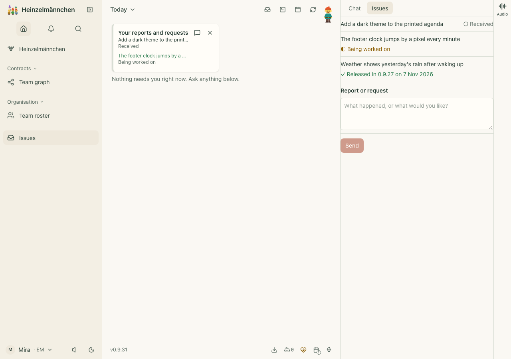
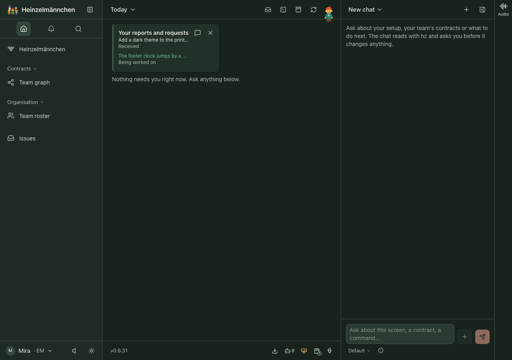
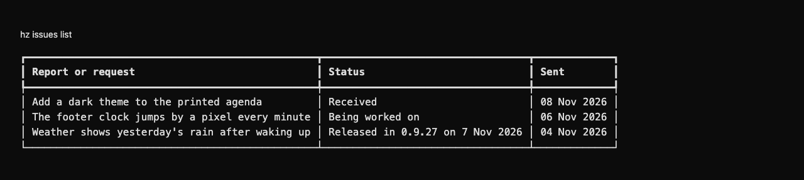

# Issues

Report a problem or request something, then see where it stands: **Received**, **Being worked on** or **Done**, and
once it ships, **Released in 0.9.27 on 7 Nov 2026**. You never see the tracker behind it: no statuses of its own,
no ids, no pull requests, unless you ask for the details.

It is not installed, bundled or recommended by default: it needs a Beads database you can write to (today the
private management repository). Add it with `hz system plugin add issues --confirm`.
Until a tracker is set up it only shows **Issue tracking is not set up** with a setup button, never an error.

## Use it

- **In the app:** open **Issues** in the sidebar. The list shows each report with its state as a word and a mark
  (○ Received, ◐ Being worked on, ✓ Done), never colour alone. Type what happened or what you would like and
  press **Send**; the app shows what it will send and asks first. With a Heinzel older than 0.9.30 the view offers
  **Report or request** instead, which opens `hz issues submit` in the app's terminal. Your open reports also appear
  on Today.
- **In a terminal:**

  ```sh
  hz issues submit "The footer clock jumps by a pixel every minute"
  hz issues submit "Here is what I saw" --attachment shot.png
  hz issues list
  ```

  `hz issues list --json` adds the details for agents and experts: the tracker, its id and status, and each pull
  request with its release. `hz issues show <id>` shows one.
- **Notices:** every five minutes the daemon looks for changes and tells you when a report is being worked on, is
  done, and when it is released. The first check after turning Issues on only remembers what is there.

When nothing is set up, the app says **Issue tracking is not set up** with one button, **Set up issue tracking**;
`hz issues list` says the same and names `hz setup issues`.

<!-- screenshots:start -->
## Screenshots



Three fictional reports: received, being worked on, and released in 0.9.27 — with a form to send another



Your open fictional reports and requests on Today, in dark mode; done ones leave the list

<details>
<summary>Command line</summary>



The same fictional reports and their plain states through the real CLI

</details>

[Open the screenshot gallery](docs/assets/screenshots/index.html).
<!-- screenshots:end -->

## Set it up

`hz setup issues` asks where reports go and, optionally, a git clone whose tags are releases. Or set it directly:

```toml
[issues]
tracker = "beads"

[issues.beads]
path = "~/Code/team-board"   # the folder with the .beads database
label = "heinzel-issues"      # what Issues gives each report, and the items it shows

[[issues.releases]]
path = "~/Code/harbor"        # a clone on this computer; read, never fetched
names = ["core"]              # how notes name it: "core #12"
ref = "origin/main"
tags = "v*"
```

`hz system doctor` reports Issues as up while it is off, and as down with the reason when a chosen tracker does
not answer.

## How "Released in" is found

Whoever works on a report notes the pull request in the tracker: `Fixed in #562`, `gh-562`, `plugins #38` or a
pull request link. Issues finds the merge commit whose subject ends in `(#562)` on the configured branch, then the
oldest release tag matching the pattern that contains it. A report with several pull requests is released when the
last of them is. The clone is only read; keep it fetched as you normally do.

## Trackers

Beads is built in: Issues runs `bd ... --json` in the configured folder, on this computer, and never syncs,
pushes or publishes. Other trackers (Linear, Jira, GitHub issues, cards in git) plug in behind the same contract,
described in [docs/CONTRACT.md](docs/CONTRACT.md), without a change to Issues or to Heinzel's core.

Issues writes to Beads through the methods of Heinzel's `Tracker` contract (core ADR 0141): each write runs
`bd --actor`, and a claim is Beads' atomic `--claim`. It registers no `tracker` capability adapter, so installing it
never unbinds or replaces the tracker other plugins (GitHub, Atlassian) use.

## Privacy

What you send stays in the tracker you chose. Issues stores only what it has already told you, under Heinzel's
state folder, readable by you only. Notices are local, like every Heinzel notice.

## Develop

From this directory: `make setup`, `make check-fast`, `make check`, `make build`, `make acceptance`. The
integration tests create a temporary Beads database and need `bd` installed; they are skipped without it.
