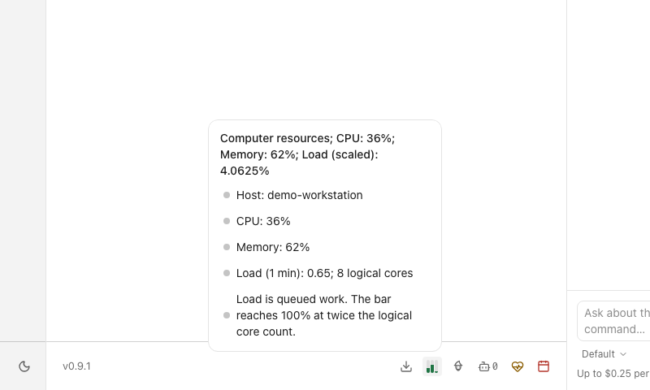
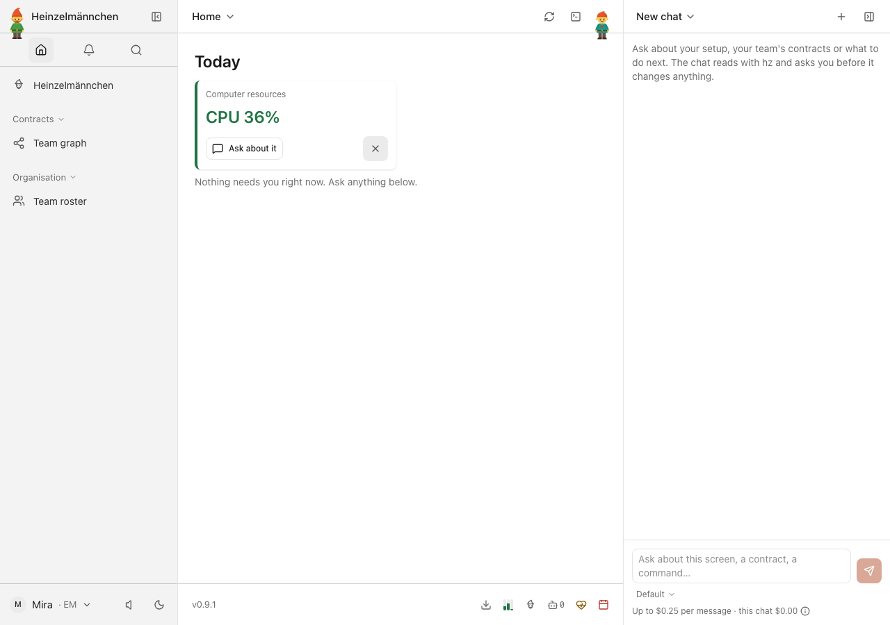
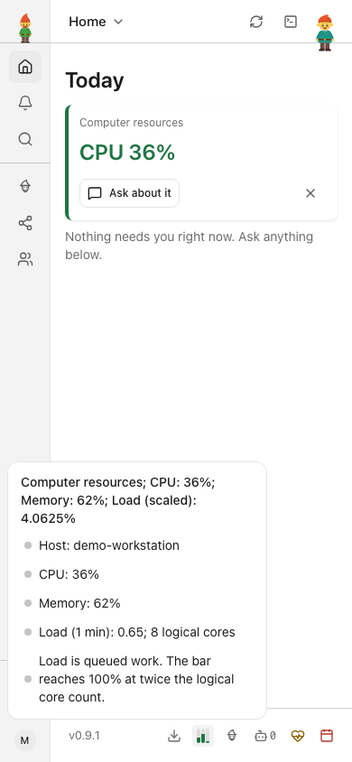
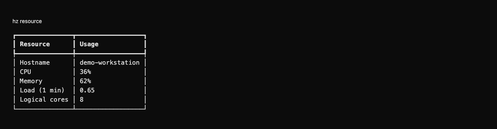

# heinzel-resource

Independently built and released Heinzelmännchen plugin.

Extracted from `system/resource` in core at b2243258; it now uses the top-level `resource` namespace. The 0.9 migration requires fresh configuration.

<!-- screenshots:start -->
## Screenshots

CPU, memory and scaled load in the expanded monitor — fictional demo workstation

A quick CPU summary on Today, with three compact footer meters — demonstration values

Read CPU, memory and queued load on a phone — fictional demo workstation

Command line

The same fictional CPU, memory and raw load measurements in the CLI

[Open the screenshot gallery](docs/assets/screenshots/index.html).
<!-- screenshots:end -->
