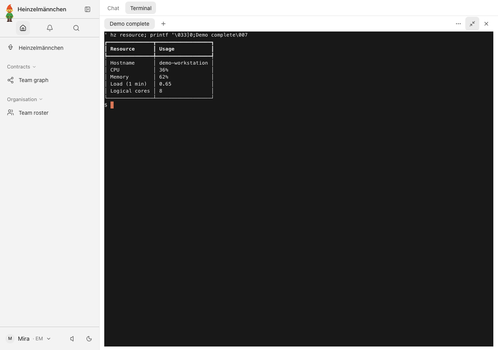

# heinzel-resource

Shows CPU, memory and load for the machine your helper runs on, on Today and in the footer.

Included in the standard app.

```bash
hz resource                # CPU, memory and load now; --json for agents
```

<!-- screenshots:start -->
## Screenshots


CPU, memory and scaled load in the expanded monitor — fictional demo workstation


A quick CPU summary on Today, with three compact footer meters — demonstration values


Read CPU, memory and queued load on a phone — fictional demo workstation



Check CPU, memory, raw load and core count in the app terminal — fictional demo-workstation values


Inspect the structured resource sample for automation in the app terminal — fictional demo-workstation data

<details>
<summary>Command line</summary>


The same fictional CPU, memory and raw load measurements in the CLI

</details>

[Open the screenshot gallery](docs/assets/screenshots/index.html).
<!-- screenshots:end -->
