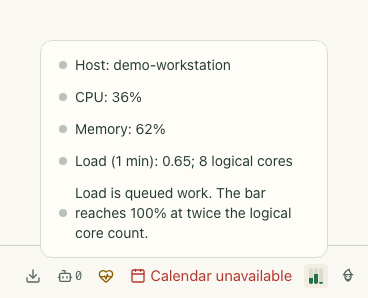
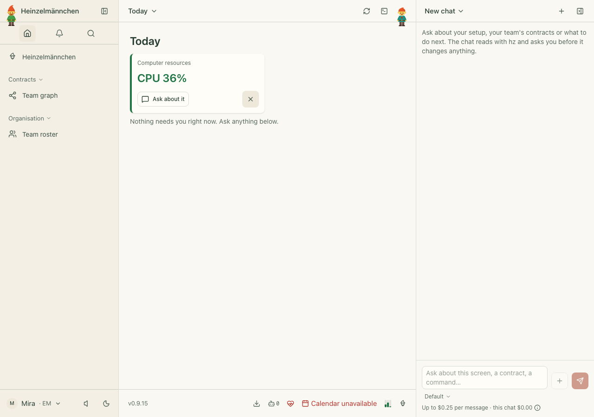
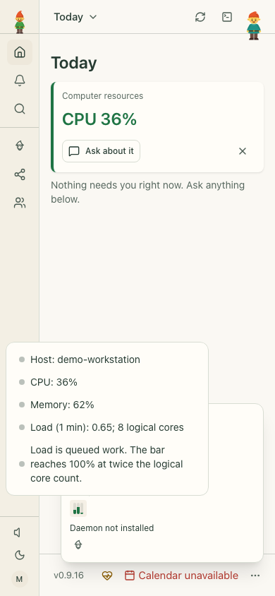
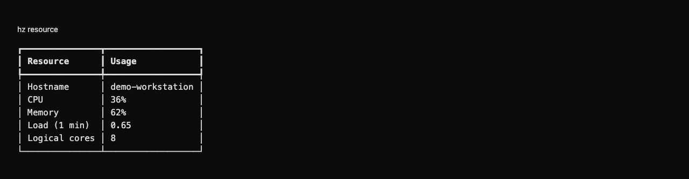
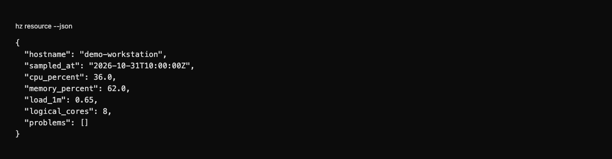

# heinzel-resource

Shows CPU, memory and load for the machine your Heinzels run on. Find the readings on Today and in the footer.

Included in the standard app.

```bash
hz resource                # CPU, memory and load now; --json for agents
```

<!-- screenshots:start -->
## Screenshots



CPU, memory and one-minute load with the core count in the expanded monitor — fictional demo workstation



A quick CPU summary on Today, with three compact footer meters — demonstration values



Read CPU, memory and one-minute load on a phone — fictional demo workstation

<details>
<summary>Command line</summary>



Fictional CPU, memory, raw load and core count in the terminal



The fictional resource sample as JSON for automation

</details>

[Open the screenshot gallery](docs/assets/screenshots/index.html).
<!-- screenshots:end -->
