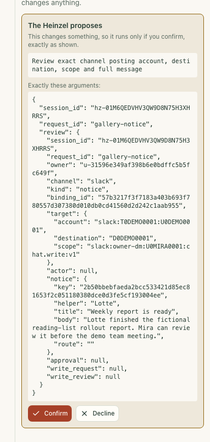
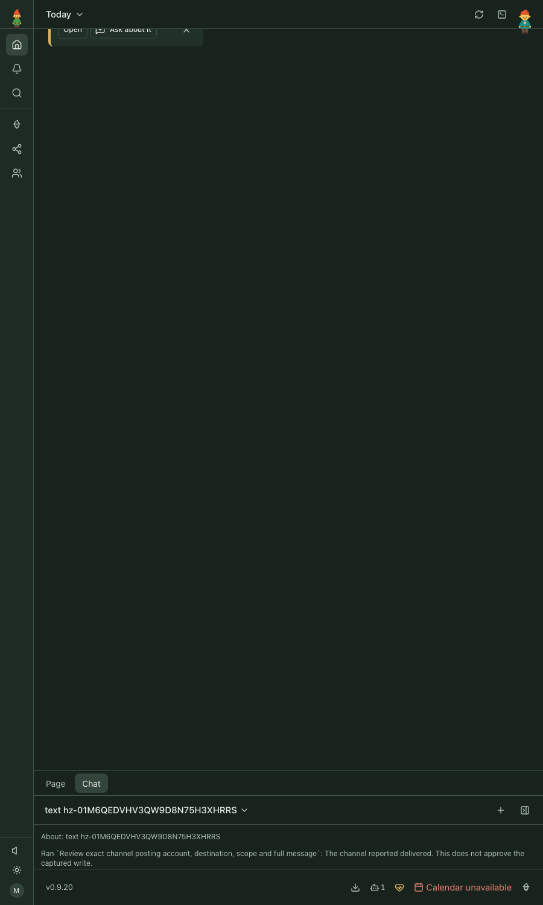
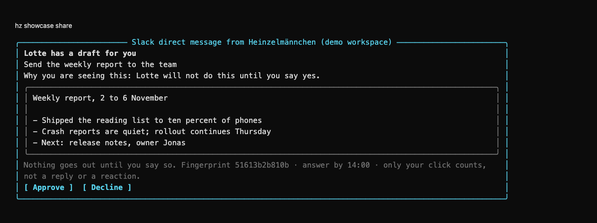
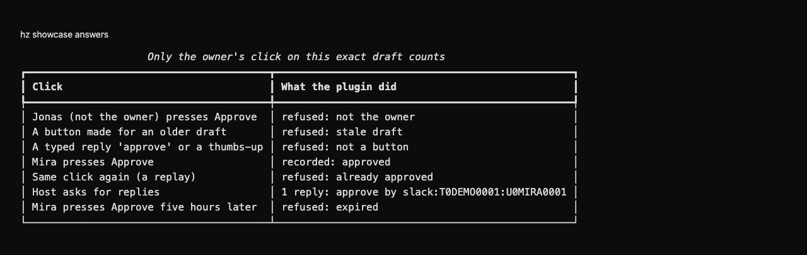

> This plugin is in development. Its offline fixtures use fictional Slack transports and accounts.
> Installed acceptance against the released SDK and a new gallery review are pending. The existing
> captures illustrate earlier behavior.

# heinzel-slack

Slack as an extra notification channel and as a place to share a draft and get a yes or no back: a
[Heinzelmännchen](https://github.com/helmut-hoffer-von-ankershoffen/heinzel) plugin, released on its own.

- **A notice says why.** Every message carries "Why you are seeing this", because a nudge that cannot say why is noise.
- **A draft is shared with Approve and Decline.** The answer is for the exact text you saw, and only you can give it.
- **Your DM only.** It writes to your direct message with your own app. Never a channel, never anyone else.

```text
Lotte has a draft for you
Weekly report
Why you are seeing this: It is Friday and you asked for a report.
| Weekly report ...                                |
Nothing goes out until you say so. Fingerprint 3fa9c1d2b4e0 · answer by 16:00 · only your click counts.
[ Approve ] [ Decline ]
```

## Prerequisites

The bot channel needs all of these. The separate reviewed-link adapter does not use the bot or app tokens.
For links-only use, explicitly run `hz system config set slack.bot_enabled false` and configure the SlackCLI
path/profile described below. The bot's local and live health checks then report it disabled without contacting
Slack; reviewed links still require their own exact account, target, grant and human approval checks.

`slack.bot_enabled true` enables the bot and reports every missing prerequisite. When unset, any configured
owner/workspace or stored bot/app token retains the existing bot setup and its missing-prerequisite checks,
even when SlackCLI selectors are also configured. An entirely unconfigured bot is optional and neutral.
`hz setup slack` explicitly enables the bot. Disabling it prevents bot sends, listening and approval consumption;
it does not grant reviewed-link delivery or remove its independent safeguards.

1. **Heinzelmännchen 0.9.20 or newer within the 0.9 series.** The development lock uses 0.9.20.
2. **A Slack workspace where you may install an app.** You create a *private app that only you use*, in your own
   workspace, from the manifest this plugin ships. If your workspace lets only admins install apps, ask for approval
   of that one app (the manifest lists exactly what it can do) or use a workspace of your own. The plugin does not
   work around that setting.
3. **Your Slack member ID**: your profile, the three dots, "Copy member ID" (like `U01ABCDEF`), and your
   **workspace ID** (like `T01ABCDEF`), configured as `slack.owner` and `slack.team`. Both are required.
4. **Two tokens from your app**, kept in the OS keychain by `hz`, never in a file or a repository:
   - the **bot token** (`xoxb-...`, on *Install App*), scopes `chat:write`, `im:write`, `users:read`;
   - an **app-level token** (`xapp-...`, on *Basic Information*, scope `connections:write`) for Socket Mode.
5. **Python 3.12+** (supplied by uv) and an internet connection to `slack.com`. No public address, no port to open.

## Set up (about three minutes)

```bash
hz slack manifest                                  # copy the JSON
# api.slack.com/apps, Create New App, From a manifest, paste it, Create, Install to Workspace.
# Basic Information, App-Level Tokens, Generate Token with connections:write.
hz system credential set bot-token --service slack
hz system credential set app-token --service slack
hz system config set slack.owner U01ABCDEF         # or: hz setup slack
hz system config set slack.team T01ABCDEF
hz system doctor                                   # then: hz system connector test slack
```

The adapter registers notification and approval ports for the core channel consumer. Registration
alone does not route notices or grant consent. In the installed offline acceptance flow, the source-bound host
reviews each exact posting target and message through its normal human confirmation surface before sending.
Consenting to post a draft does not approve that draft: an owner click is a separate claim the host verifies.
The plugin operations can be used explicitly:

```bash
hz slack notify "Build done" "You asked to know when it finishes." --helper Otto
hz slack ask "Send the weekly report" "$(cat report.md)" --helper Lotte
hz slack wait <request-id>        # listens for your click, up to --seconds; or: hz slack status <request-id>
```

**Clicks are only registered while something listens** (`wait`, `listen`, or the five-minute `listen` job while a draft is waiting). A button pressed with
nobody listening shows Slack's "not responding" notice and the draft stays waiting; press it again once `hz` listens.
The message says nothing false in the meantime: it still shows the buttons because it is still unanswered.

## What approval means here

Approval follows a typed code path (T3). `DraftStanding.approves(draft)` checks an approved state and the exact
draft digest. A host consuming `ChannelApprovalReply` must separately validate the request, actor, argument digest
and expiry before acting. The plugin records a decision only if all of this held:

| Held at click time | How |
| --- | --- |
| It is a **button** press on our message | Replies, reactions and slash commands are not even subscribed to, and any such payload is refused |
| The person is **you** | The clicker's Slack ID equals the owner recorded *before* posting; a project `hz.toml` cannot set it |
| Right **workspace, conversation and message** | Compared with what was recorded when the message was posted |
| The **exact bytes** | The button carries the host argument digest; the stored preview is hashed again under the lock; `DraftStanding.approves(draft)` hashes what you pass |
| Still **fresh** | Pending, not expired (default 4 hours), click time plausible; replacing a draft requires an explicit host `settle(reference, "superseded")` call |
| **Once** | The move from pending to decided is a single atomic update, so a second click, a Slack retry or a replay is refused |

Everything else from Slack is data. Only identifiers are read; message text, names and replies are never parsed for
meaning. A draft containing control, zero-width or bidirectional characters is refused (it could not be reviewed as
it is), and a draft over 4,000 characters is refused (you could not read it all in Slack). The draft is shown in a
literal preformatted block, so mentions and links in it are inert. Refused clicks are recorded in the audit trail
(`approvals.sqlite3` in the state folder, readable by you only) with a code of ours, never Slack's text.

What this does **not** prove: that a human, rather than software running as you in Slack, pressed the button. It is an
application-level decision by the owner's Slack account, as in `hz` core's own confirmations. Anyone who controls
your Slack account or the machine controls your approvals.

## Why your own app and not a browser session or the Slack CLI

| Approach | Verdict |
| --- | --- |
| **Browser session tokens** (community CLIs such as `slackcli` with `xoxc`/`xoxd`) | Acts as you, nothing to install, but it is an unofficial use of your login that Slack can break or forbid at any time, tokens die when you sign out, and it cannot receive button clicks. Approval would be a reaction or a typed reply, which cannot be bound to the exact bytes. Not a dependency for a product. |
| **The official Slack CLI** (`slack`) | Builds and runs apps on Slack's platform and manages manifests; it has no way to post a message or receive a click for another tool. Useful for creating and installing the app during development. |
| **A private Slack app** (this plugin): bot token for the Web API, Socket Mode for clicks, official `slack-sdk` | Supported by Slack, least privilege (three bot scopes, no user scope, no event subscriptions), signed identity of the clicker in every click, and no inbound address, so nothing is hosted. **Chosen.** |

Tenets weighed: P1 ("your identity over a bot identity") and ADR 0035 ("only what an ordinary employee may do, no admin-registered
apps") against T3 and P2 (approval must be bound and verifiable) and distributability. The app here is yours alone, in
your workspace, created by you, and it only ever writes to your own DM as a mailbox: it never posts as you and never to
a shared channel. Anything published under your name later is a separate step with your identity. If you cannot install an
app, the plugin reports so; it does not fall back to a browser session.

## Ports

The plugin registers one service, `SlackChannel`, a `NotificationChannel` and an `ApprovalChannel` as the candidate
SDK defines them; core imports nothing from this plugin and names no Slack. A channel carries words and never decides:

- `delivery_target()` observes a `ChannelTarget`: authenticated workspace/bot account, exact owner DM, and
  versioned owner-bound posting scope. This observation posts no message and grants no authority.
- `deliver_reviewed(notice, target)` and `post_reviewed(request, target)` require that exact target. They verify it
  again at mutation using the same immutable credential selection and SDK client that will post, with retries
  disabled. A changed account, DM or scope refuses without a post; legacy methods are never a host fallback.
- `deliver(notice)` is the explicit plugin operation path and posts at most once per `key`. The receipt says what
  was observed: `delivered`, `refused` (Slack said no, safe to retry) or `unknown` (the answer was lost, so it may have been sent and is never retried by itself).
- `post(request)` shows the exact preview with Approve and Decline, bound to the request's `arguments_sha256` and expiry,
  idempotent by `request_id`. `replies(references)` returns only clicks that passed every check above, with the owner's
  workspace and member ID as the actor; the host must check that actor, digest and expiry again before it
  consumes any approval.
- `settle(reference, outcome)` is an explicit host call to close the message once the host has acted, expired it or
  replaced it. Posting another request never supersedes an earlier one automatically. Every message update first
  verifies that current credentials address the recorded workspace and the owner's recorded DM.

Credential selection is pinned for each conditional call. Rotating credentials after the client is acquired cannot
redirect that call; it does not transactionally cancel an already pinned, correctly reviewed operation. Revocation
can make Slack refuse it, while a lost acknowledgement remains `unknown` and is never retried automatically.

For development against a different compatible core artifact, select its wheel with `CORE=<wheel>`.

## Development

```bash
make check-fast
```

The closed SDK subset, upstream wheel pin, license and regeneration policy are described in
[the vendoring notes](docs/VENDORING.md). Vendor-aware tooling verifies exact upstream and projected bytes before
formatting, checks or builds, and verifies the built wheel again. Only verified upstream implementation files receive
dependency treatment; first-party lint, strict typing and the 90% coverage floor remain unchanged.

The in-memory Slack in `tests/conftest.py` is a labelled fake. `tests/e2e/live_test.py` talks to a real workspace when
`SLACK_PROOF=1`; the tokens come from the environment (the official `slack run` injects them without printing them).

<!-- screenshots:start -->
## Screenshots



Demo data: Mira reviews the fictional Slack account, destination, scope and complete weekly-report notice before delivery.



Demo data: Core reports the fictional notice delivered to the local stand-in after Mira confirms; this does not approve a captured write.

<details>
<summary>Command line</summary>



Demo data: the fictional weekly-report draft and printed button labels, rendered in the terminal from Slack message blocks.



Demo data: fictional clicks exercise the real decision code; Mira&#x27;s exact approval records one reply while invalid attempts are refused.

</details>

[Open the screenshot gallery](docs/assets/screenshots/index.html).
<!-- screenshots:end -->

### Approved document links through SlackCLI

The separate source-only `SlackReviewedLinks` companion uses an existing SlackCLI 0.18.0 browser profile.
Its workflow channel name is `slack-reviewed-links`, registered in the separate `slack.links` module record.
The existing `slack` bot channel retains its own unique ordinary notification and approval service. Select
an absolute native executable with `slack.cli_path` and the exact stored profile key with `slack.cli_profile`.
These owner settings are ignored in project configuration. It resolves the authenticated user's existing self DM
before the host asks for approval, and binds that account, destination and captured source into the reviewed target.
It sends only the exact approved Google Doc URL. Private review notices use the host's ordinary app notifications.

No bot or app token is required for this companion. File-backed browser profiles are privately pinned along with the
native binary; keychain-backed profiles and standard-token SDK profiles refuse. The standard SDK transport may retry
uncertain writes, so that mode cannot satisfy this companion's acknowledgement contract. Missing or ambiguous self
DMs refuse without creating a conversation. The exact selected CLI source and destination are checked again after
the durable delivery intent. Timeout, malformed acknowledgement and replay retain uncertainty and never resend.
The existing bot-backed notice/approval channel and its verified SDK projection remain separate.

The reviewed CLI behavior comes from [SlackCLI v0.18.0](https://github.com/shaharia-lab/slackcli/tree/v0.18.0),
including its fixed home-relative profile store, explicit workspace selector, browser-write retry policy and structured
message acknowledgement. Local contract tests use fictional profiles and provider replies. Live account delivery
and installed acceptance against the released SDK still need verification.
