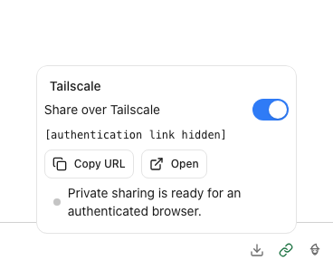
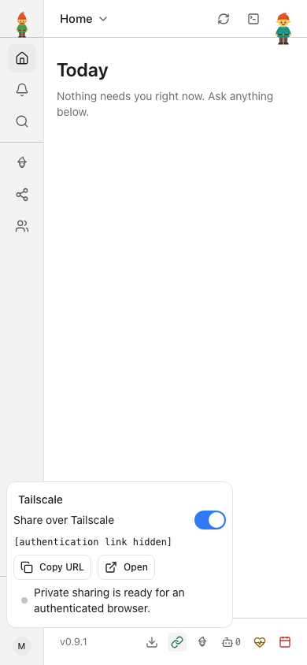
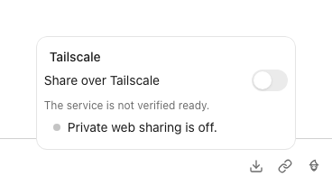
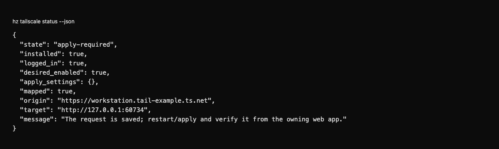
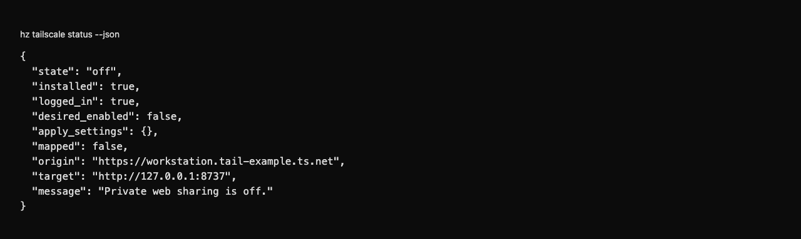

# Tailscale private web sharing

A first-party adapter for the installed Tailscale client. It keeps the web app's bearer/device authentication and
loopback listener; tailnet membership does not grant access to the backend owner's operations or terminal.

Included in the standard app; sharing stays off until you turn it on. Tailscale
itself must already be installed and signed in; hz does not install it, log in, grant HTTPS consent or change OS
permissions for you.
On macOS it also detects the CLI bundled in `/Applications/Tailscale.app` and explicitly selects CLI mode, as
described in [Tailscale's CLI documentation](https://tailscale.com/docs/reference/tailscale-cli?tab=macos).

In Settings or the footer's sharing icon, turn **Share over Tailscale** on. The control checks the node and existing
Serve mappings, merges its exact HTTPS origin into your user configuration and configures its loopback target. The
running web app applies the updated origin policy immediately; it does not require a backend restart. It shows ON and
a URL only after the owning authenticated web app verifies its actual port, active origin policy and matching Serve
configuration. A CLI/stdio MCP request saves the same intent but reports verification pending until that web owner
verifies it. Status reads never enable sharing.

```sh
hz tailscale status --json
hz tailscale enable --json
hz tailscale disable --json
```

The corresponding private operations are available through authenticated API and stdio MCP. They are absent from
the unauthenticated REST and HTTP MCP heads. In-process calls use the actual bound web port. A separate CLI retains
a previously observed port override; it cannot discover an arbitrary ephemeral web listener or claim it is ready.

**Copy URL** copies a working link with the current `#token=...` session fragment when the authenticated session has
one. Treat that link like a password: anyone who receives it can use that session until it is revoked or expires. If
there is no session token, the control copies only the address. A fresh phone browser also needs authentication: use
the separate **Copy sign-in link** action from the session owner, then pair that browser. Pairing a device never grants
it authority to pair another device. See [private web sharing](https://github.com/helmut-hoffer-von-ankershoffen/heinzel/blob/main/docs/PRIVATE_WEB_SHARING.md) for authentication
and revocation.

Turning sharing off removes only the still-matching hz root handler and any origin permission this plugin added.
Other paths, listeners, services and manually configured origins remain. An existing conflicting root, public
Funnel setting, foreground session or higher-priority origin policy is refused. A changed Serve revision or unknown
write outcome stops without retry or rollback; inspect current status before taking another action.
Matching an existing manual handler does not make it owned by hz, so enabling refuses to adopt it. OFF without an
owned request is non-destructive. Completed removal relinquishes ownership before cleanup; repeating OFF cannot
delete a later manual recreation. An uncertain create remains unverified and needs inspection before deletion.

`tailscale.https_port` chooses an alternate HTTPS port when another app owns the default. Disable a previous request
before changing its external origin. A Tailscale version must provide the conditional Serve LocalAPI and one of the
recognized local endpoint formats. Unsupported client installations report an actionable error; no sudo or remote
endpoint fallback is attempted. The exact node DNS name must be eligible for HTTPS certificates in Tailscale's own
configuration. Readiness verifies the local deployment; actual phone access still depends on Tailscale login,
network policy and the remote browser's credential.

Development and release commands: [repository guide](../../README.md).


<!-- screenshots:start -->
## Screenshots



Enable private sharing and see verified readiness — fictional local Tailscale demo



Inspect the private link at phone width — fictional local Tailscale demo; no remote connection tested



Turn private sharing off explicitly — fictional local Tailscale demo

<details>
<summary>Command line</summary>



Inspect saved intent and mapping, with web verification pending — fictional local Tailscale demo in a separate CLI process



Confirm the owned mapping is gone and the request is off — fictional local Tailscale demo

</details>

[Open the screenshot gallery](docs/assets/screenshots/index.html).
<!-- screenshots:end -->
