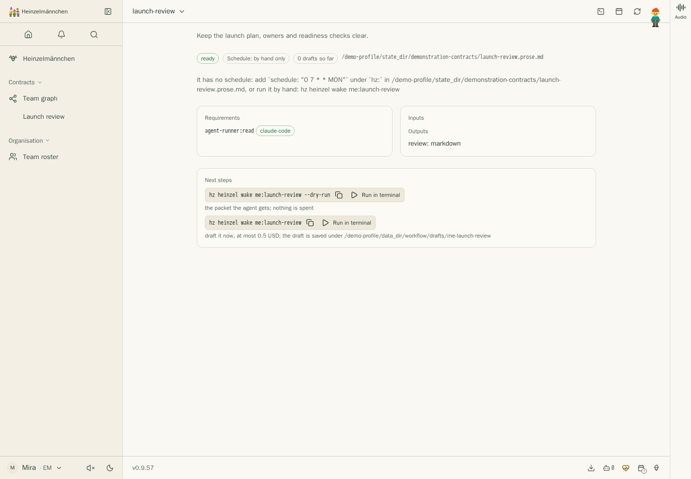
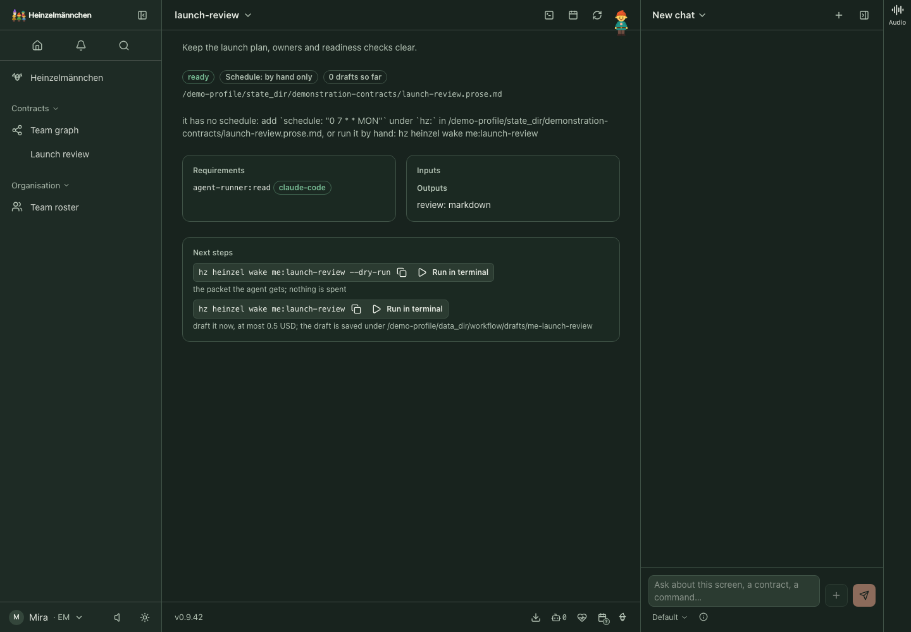
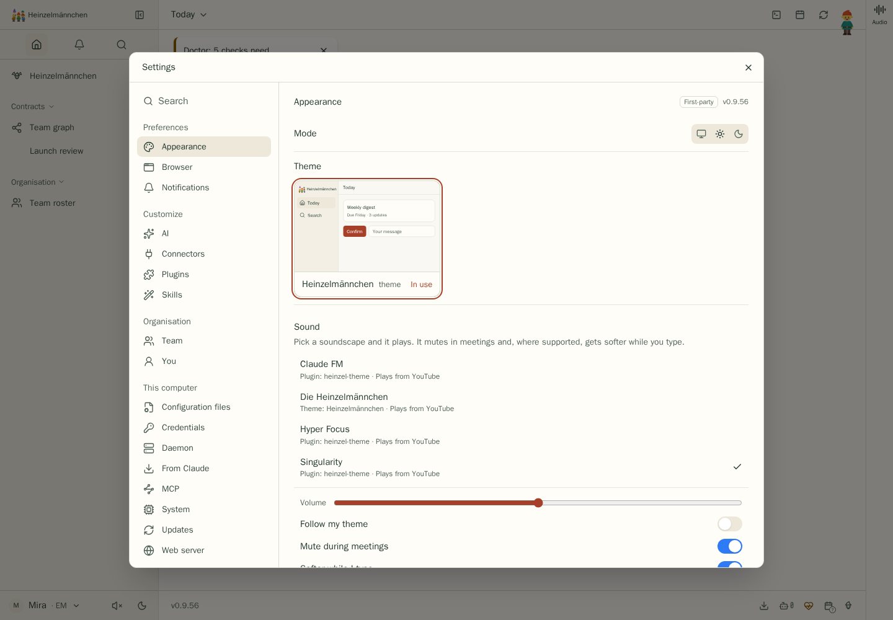
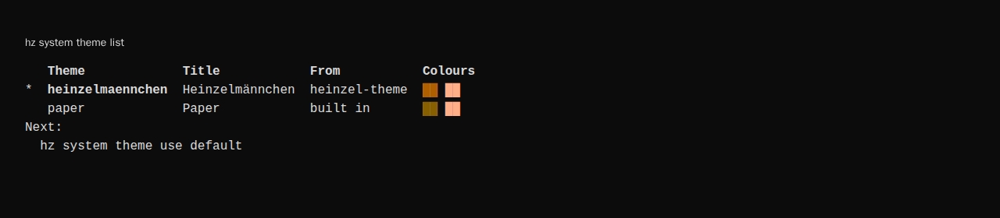
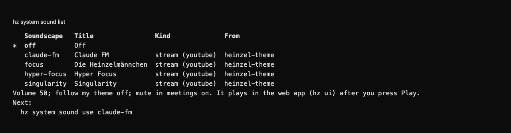

# Heinzelmännchen theme

The standard Heinzelmännchen appearance and its four soundscapes: Claude FM, Die Heinzelmännchen, Hyper Focus and Singularity.

Included in the standard app. It recommends its appearance when no available
theme has been selected. An explicit available theme choice is preserved, and the inactive built-in fallback is hidden
to avoid duplicate previews. Sound starts only after the person presses Play.

Select **Heinzelmännchen** in Settings → Appearance, or run `hz system theme use heinzelmaennchen`. With **Follow my
theme** enabled, its paired soundscape is Die Heinzelmännchen (`focus`). Choose any of its soundscapes manually with
`hz system sound use claude-fm`, `focus`, `hyper-focus` or `singularity`.

Singularity is the default soundscape of Core 0.9.55 and later for anyone who never chose one (an explicit choice,
`off` included, always wins); older Cores keep `off` as the default and still offer it. It plays the video
`AvtStYuO79Y` alone, no playlist, and only after the person presses Play.

All theme values, logos, soundscape definitions, pairing and tests belong to this directory. The plugin uses public
`module.theme` and `module.soundscape` declarations. It imports no other plugin or core implementation. Disabling
or removing it restores core's fallback appearance and leaves unavailable sound choices silent.

From the repository root, run `make lock`, `make check`, `make build` and `make acceptance` with `NAME=heinzel-theme`
and `CORE=<compatible-core-wheel>`. Only this plugin's environment and tests are used. New content requires no core
or parent registry change.

<!-- screenshots:start -->
## Screenshots

A fictional Launch review contract and its readiness checks in the applied Heinzelmännchen light theme.

The same fictional Launch review contract in the applied Heinzelmännchen dark theme.

Demo profile: browse the four optional soundscapes in Appearance settings without starting playback.

Command line

Demo profile: list available themes and identify Heinzelmännchen from the CLI.

Demo profile: list the available soundscapes without starting playback.

[Open the screenshot gallery](docs/assets/screenshots/index.html).
<!-- screenshots:end -->
