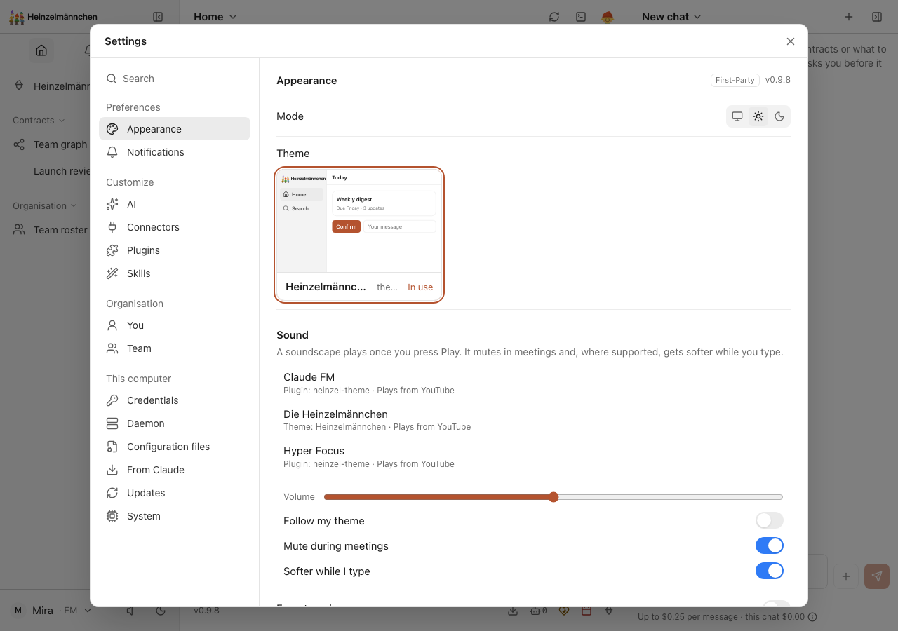
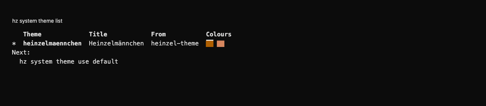
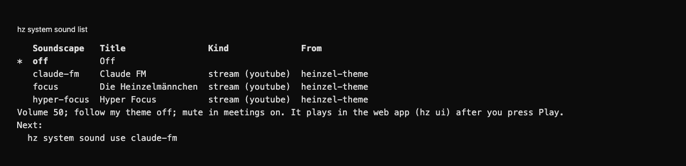

# Heinzelmännchen theme

The standard Heinzelmännchen appearance and its three soundscapes: Claude FM, Die Heinzelmännchen and Hyper Focus.

Included in the standard app. It recommends its appearance when no available
theme has been selected. An explicit available theme choice is preserved, and the inactive built-in fallback is hidden
to avoid duplicate previews. Sound starts only after the person presses Play.

Select **Heinzelmännchen** in Settings → Appearance, or run `hz system theme use heinzelmaennchen`. With **Follow my
theme** enabled, its paired soundscape is Die Heinzelmännchen (`focus`). Choose any of its soundscapes manually with
`hz system sound use claude-fm`, `hz system sound use focus` or `hz system sound use hyper-focus`.

All theme values, logos, soundscape definitions, pairing and tests belong to this directory. The plugin uses public
`module.theme` and `module.soundscape` declarations. It imports no other plugin or core implementation. Disabling
or removing it restores core's fallback appearance and leaves unavailable sound choices silent.

From the repository root, run `make lock`, `make check`, `make build` and `make acceptance` with `NAME=heinzel-theme`
and `CORE=<compatible-core-wheel>`. Only this plugin's environment and tests are used. New content requires no core
or parent registry change.

<!-- screenshots:start -->
## Screenshots

A fictional Launch review contract, its configuration and run commands, in the applied Heinzelmännchen light theme.

The same fictional Launch review contract in the applied Heinzelmännchen dark theme.

Demo profile: browse three optional YouTube soundscapes; playback starts only after Play.

Command line

Demo profile: list available themes and identify Heinzelmännchen from the CLI.

Demo profile: list Claude FM, Die Heinzelmännchen and Hyper Focus without starting playback.

[Open the screenshot gallery](docs/assets/screenshots/index.html).
<!-- screenshots:end -->
