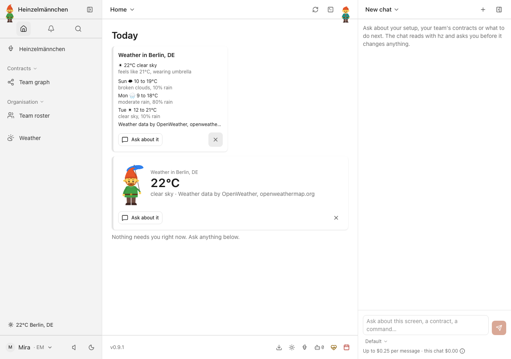
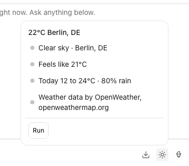
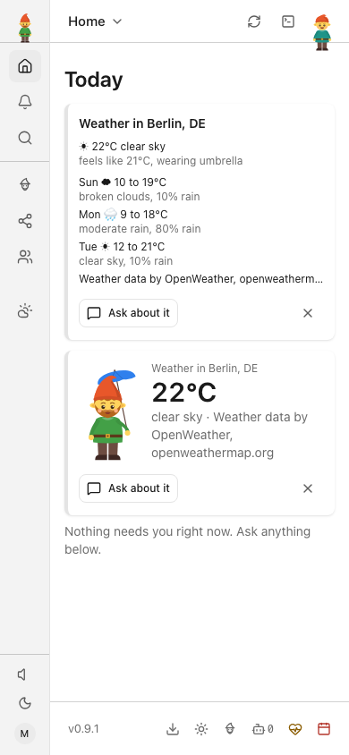
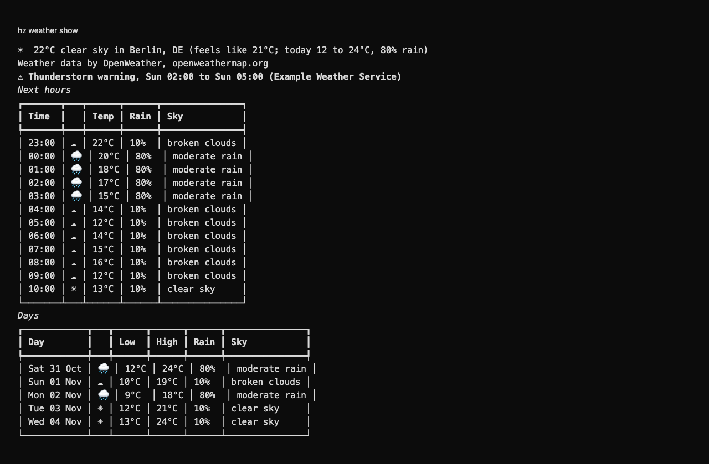
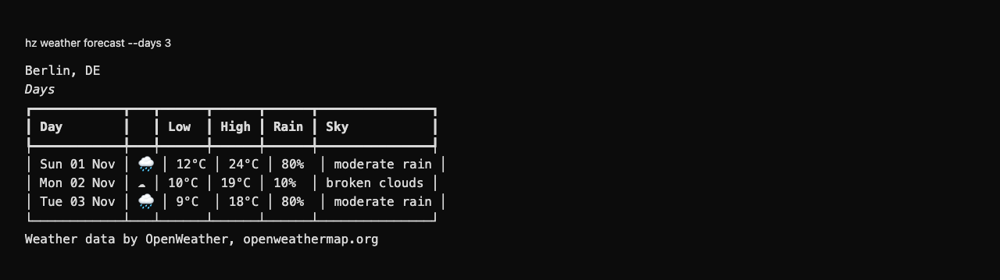

# heinzel-weather

Weather where you are, keyless by default from [Open-Meteo](https://open-meteo.com): now, the next hours and days, and
a heads-up when it changes. Bring an [OpenWeather](https://openweathermap.org) key instead if you prefer it. A plugin
for [Heinzelmännchen](https://github.com/helmut-hoffer-von-ankershoffen/heinzel).

Install it with:

```bash
hz system plugin add weather --confirm
hz setup weather    # your places and the units (and the provider; Open-Meteo needs no key)
```

Open-Meteo needs no account and no key. Its data is licensed [CC BY 4.0](https://creativecommons.org/licenses/by/4.0/)
and free for non-commercial use, so it is credited wherever the weather shows: in the status item's detail, on the Today
list and graphic, in CLI output and structured results, and in notices. It has no severe weather alerts.
Location queries are redacted from request logs; an Open-Meteo response is stopped after 2 MB instead of downloading
an unbounded body.

With `weather.provider = "openweather"` the API key is a credential, kept in your keychain
(`hz system credential set weather.api-key`) or read from `HZ_CREDENTIAL_WEATHER_API_KEY`, else `OPENWEATHER_API_KEY`;
never from a config file. It needs OpenWeather's One Call API 3.0, free up to 1,000 calls a day once you subscribe to it
at openweathermap.org; it also brings severe weather alerts.

## In the web app

Contributed as data (ADR 0056), nothing to install on the app's side:

- A status item in the footer and the sidebar: the temperature and sky, with the place, feels-like, what the
  Heinzelmännchen wears and the attribution on hover; a click opens `hz weather show` in the terminal.
- Today: a graphic with the temperature beside the Heinzelmännchen dressed for the weather (an umbrella in or near rain,
  sunglasses in clear daylight, a scarf in the cold), and a list of the next days with the attribution.
- Notices (the daemon's `weather.watch` job) when rain starts within the hour, the temperature swings or, with
  OpenWeather, an alert is issued.

Until a place is set, the status item says "Set a location".

## Use

| Surface | CLI | MCP tool | REST (`hz system serve api`, and `/api/...` in `hz ui`) |
| --- | --- | --- | --- |
| The weather now at your primary location, with today's high, low and rain chance | `hz weather` | `weather` | `GET /weather` |
| Current weather and its coordinates, the next 12 hours, 5 days and severe weather alerts | `hz weather show [--location PLACE]` | `weather_show` | `GET /weather/show?location=...` |
| The next days | `hz weather forecast [--location PLACE] [--days N]` | `weather_forecast` | `GET /weather/forecast` |
| What the app shows: the weather now, the days, what to wear, the attribution | `hz weather conditions` | `weather_conditions` | `GET /weather/conditions` |
| Shared timestamped report and candidate changes, without notices | `hz weather observe` | `weather_observe` | `GET /weather/observe` |
| The provider, the plugin version and the attribution the data asks for | `hz weather info` | `weather_info` | `GET /weather/info` |
| What a theme can follow: the weather in one word, sunrise, sunset | `hz weather signals` | `weather_signals` | `GET /weather/signals` |
| Notices when rain starts within the hour, the temperature swings, or an alert is issued | the daemon's `weather.watch` job | | |
| Whether a place (and, with OpenWeather, a key) is set | `hz system doctor` | `system_doctor` | `GET /system/doctor` |

Every command takes `--json`. A place is a city and country (`"Lisbon, PT"`) or coordinates (`"38.72,-9.14"`).

In `hz ui`, Weather adds a condition and temperature status item to the footer and sidebar, a detailed Today card, and
a Weather entry under Settings. The status and card share one plugin observation, refreshed every
15 minutes; if a refresh fails, they keep the last observation and mark it stale. The Settings/sidebar entry opens the
full forecast command.

## Settings

| Key | Default | |
| --- | --- | --- |
| `weather.provider` | `open-meteo` | `open-meteo` (no key) or `openweather` (your key) |
| `weather.locations` | none | Your places, yours first |
| `weather.units` | by locale | `metric` or `imperial` |
| `weather.refresh_minutes` | 15 | How often the job checks the forecast |
| `weather.rain_chance` | 0.5 | From which chance rain within the hour is news |
| `weather.temperature_swing` | 8 | Degrees within 12 hours that are news |
| `weather.base_url` | `https://api.openweathermap.org` | OpenWeather only: https, or http on 127.0.0.1 for the fake below |

Notices are de-duplicated: each change once, and rain at most once in three hours per place.

## Try OpenWeather offline: the fake OpenWeather

```bash
python -m heinzel_weather.fake --port 8787 &
HZ_WEATHER__PROVIDER=openweather HZ_WEATHER__BASE_URL=http://127.0.0.1:8787 HZ_WEATHER__LOCATIONS='["Berlin, DE"]' OPENWEATHER_API_KEY=fake hz weather show
```

Fixed weather relative to the current hour: 21.5 °C and clear now, rain from the next hour, a thunderstorm warning.
The tests and the docs' recordings use the same fake (`heinzel_weather.fake`).

Development and release commands: [repository guide](../../README.md).

## Observations and trend advice

`hz weather observe --json` is a read-only report for workflows; it does not send notices. The plugin also ships the
`weather-trend` skill: `hz system skill show weather-trend`. Details: [ADR 0002](docs/adr/0002-weather-observations-and-trend-advice.md).

<!-- screenshots:start -->
## Screenshots



Current weather and the coming days on Today — fictional Berlin forecast



Inspect conditions, feels-like temperature and rain chance — fictional local forecast



Weather and near forecast in the phone-sized Today view — fictional local forecast

<details>
<summary>Command line</summary>



Hourly conditions and approaching rain through the real CLI — local fictional forecast



A concise three-day outlook through the real CLI — local fictional forecast

</details>

[Open the screenshot gallery](docs/assets/screenshots/index.html).
<!-- screenshots:end -->
