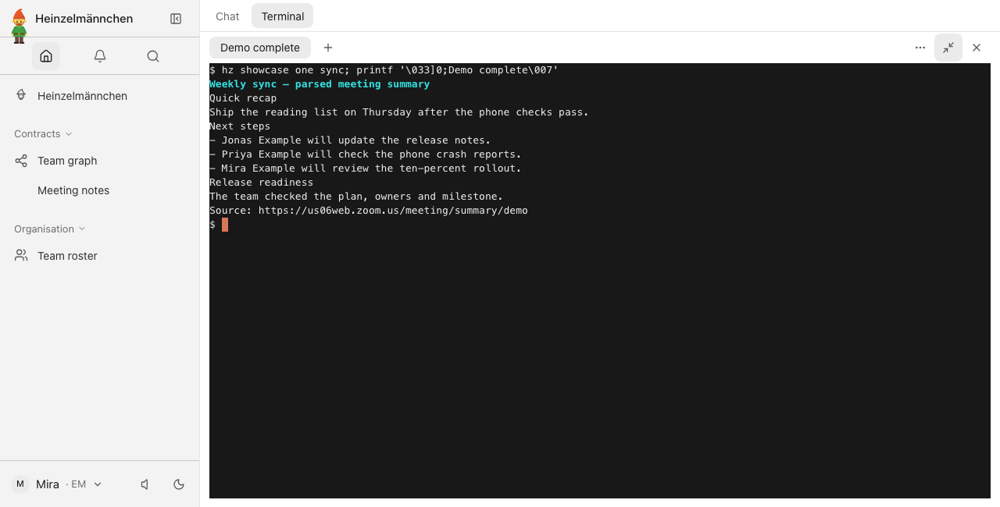
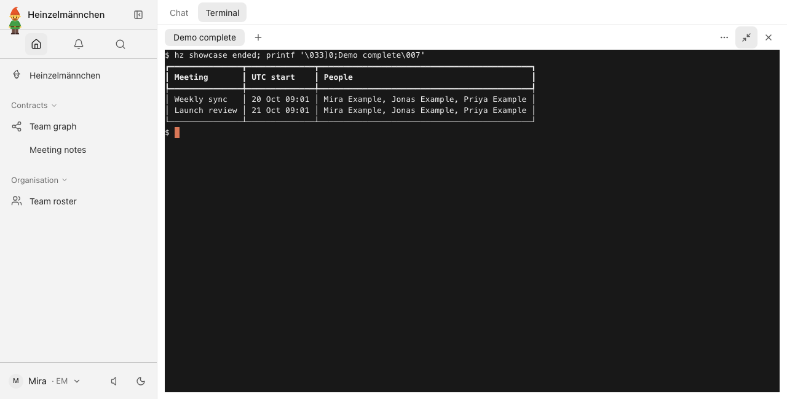
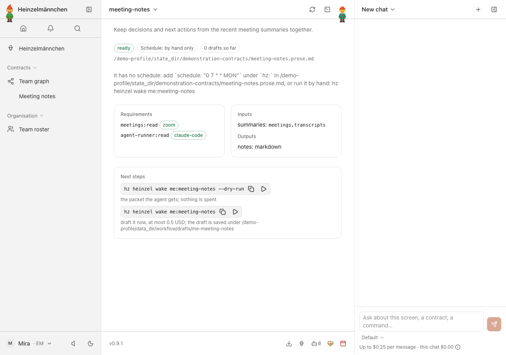
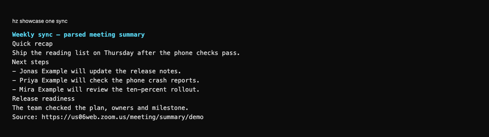
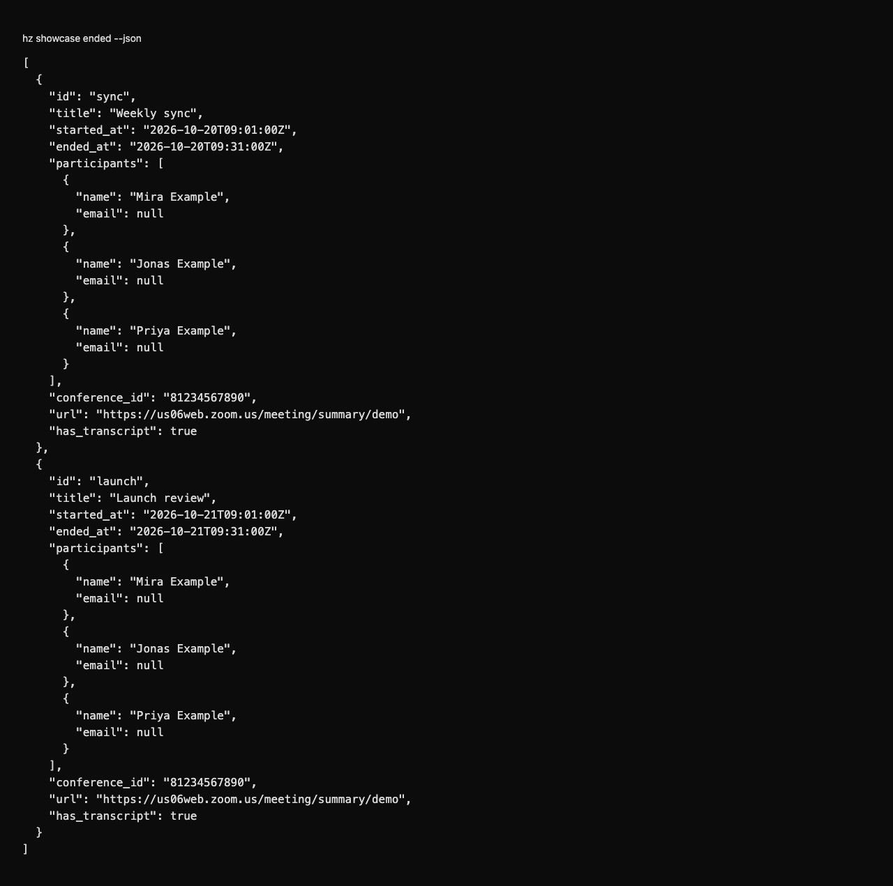

# heinzel-zoom

Read the meetings you held on Zoom, and what was decided in them, from the meeting-summary emails Zoom sends: the
`meetings` capability ([ADR 0028](https://github.com/helmut-hoffer-von-ankershoffen/heinzel/blob/main/docs/adr/0028-integrations-are-capability-adapters.md)), a first-party
[Heinzelmännchen](https://github.com/helmut-hoffer-von-ankershoffen/heinzel) plugin. It reads those emails through whichever adapter serves `mail`, so it needs
no Zoom API access and no Zoom credentials. It is independently released and installed explicitly:

```bash
hz system plugin add zoom --confirm             # a compatible plugin release; run it again to upgrade
hz system plugin remove heinzel-zoom
```

## Set up

1. **Have Zoom mail you its summaries.** In the Zoom web portal, go to **Settings > AI Companion > Meeting summary
   with AI Companion**. Switch it on and share summaries by email with yourself: as the host, or as an invitee when
   the host shares them. An account admin may have to allow this first. Zoom sends the summary when the meeting ends.
2. **Bind a mail adapter** that reads the mailbox the summaries arrive in, for example the Google Workspace plugin's,
   or your company's own. Then bind this plugin to `meetings`. Use your user configuration, never a project
   `hz.toml`, which Heinzelmännchen ignores for bindings:

   ```bash
   hz system config set capabilities.mail <a mail adapter>
   hz system config set capabilities.meetings zoom
   ```

`hz system doctor` checks both bindings and says where summaries are switched on. It reads no mail and contacts
nothing.

### Is it connected?

Bound automatically to `meetings` while it is the only installed adapter, [ADR
0055](https://github.com/helmut-hoffer-von-ankershoffen/heinzel/blob/main/docs/adr/0055-connectors-show-their-sign-in-test-live-on-demand-and-bind-themselves-when-alone.md). It has
no sign-in of its own: `hz system connector test zoom` lists the last day's summary emails through the bound mail
adapter (no message is opened), and only when you run it.

## Use

Workflows ask for `meetings`, never for Zoom:

```python
from datetime import datetime

from heinzel import Meetings, Module, Transcript, Window

module = Module("prep", "One-on-one preparation.", requires=["meetings:read"])


@module.operation
def decided(meetings: Meetings, since: datetime, until: datetime) -> list[Transcript]:
    """What this week's meetings decided."""
    return meetings.transcripts(Window(since=since, until=until))
```

| Method | What it reads |
| --- | --- |
| `ended(window)` | `mail.messages(zoom.query, window)`, keeping messages whose subject is a Zoom summary, then each one with `mail.read` |
| `transcripts(window)` | the same messages, each summary that has sections as a transcript |
| `transcript(meeting)` | `mail.read(meeting)`, refused unless it matches `zoom.query` and is a Zoom summary |

What a meeting holds:

- **`Meeting.id`**: the summary email's id.
- **`title`**: taken from the subject, `Meeting summary for <title> (<date>)` or `Meeting assets for <title> are
  ready!`.
- **`conference_id`**: the meeting number, from `Meeting ID:` in the body, so a calendar event can be matched to it.
- **`ended_at` and `started_at`**: the meeting ended when the summary arrived. It started that long before if the
  summary states a `Duration:`; otherwise both times are when the summary arrived.
- **`participants`**: names only, and only when the summary lists them.

A transcript here is the summary, not a verbatim record, because Zoom's summary emails contain no transcript. It has
one segment per section (`Quick recap`, `Next steps`, and each topic under `Summary`), without a speaker, at offset 0.

Replies and forwards (`Re:`, `Fwd:`) are someone's mail about a summary, not Zoom's, so they are skipped. The
summary's content ends at Zoom's footer. Links keep no query or fragment, which could carry an address or a token.

Mail stays private:

- Every string passes `clean_text`.
- A name that is an email address is dropped.
- An address in the summary's text becomes `[address]`.
- Senders' addresses never reach a workflow's agent, because the packet builder drops them.

Limits: a message longer than 200,000 characters is no Zoom summary, so a window skips it and `transcript` refuses
it. A window with more than 500 summaries or more than 2,000,000 characters of them fails and says to ask for a
shorter one. The mail adapter applies its own limits too. Each summary is read with its own `mail.read`, one after the
other.

```bash
hz zoom info                    # this plugin, its version and the mail query it uses
hz system capability list       # who reads what, through which adapter and hosts
hz system doctor                # bindings and where summaries are switched on; reads no mail
```

## Settings

```toml
[zoom]
query = "from:zoom.us"   # the mail query that finds Zoom's summaries; ignored in a project hz.toml
```

`query` uses the mail capability's syntax: `from:`, `subject:` and `label:`, for example
`from:zoom.us label:Meetings` for summaries a mail filter files under a label. Messages whose subject isn't a Zoom
summary are skipped. The plugin itself sends nothing anywhere: `hz system capability list` shows no hosts for it, and
the mail adapter's own hosts for `mail`.

Development and release commands: [repository guide](../../README.md).

Migration provenance: heinzel, before the 0.9 plugin-boundary migration.

<!-- screenshots:start -->
## Screenshots



Decisions and next steps from a summary email — fixture-only requester, real Zoom parser



Find the recent summarized meetings — fixture-only requester and fictional mailbox



Meeting notes combines the declared source inputs — local demonstration, no report generated

<details>
<summary>Command line</summary>



Read a meeting summary in the shell — fixture-only requester, real Zoom parser and fictional mailbox



Structured summarized-meeting results for workflows — fixture-only requester, no verbatim transcription

</details>

[Open the screenshot gallery](docs/assets/screenshots/index.html).
<!-- screenshots:end -->
